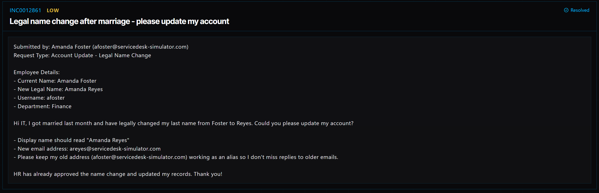

# Ticket 008: Employee Legal Name and Email Update

## Ticket Information
- **Platform:** ServiceDesk Simulator
- **Incident ID:** INC0012861
- **Status:** Resolved
- **Priority:** Low
- **Ticket Type:** Account Management / Legal Name Change
- **Environment:** Simulated IT support environment
- **Submitted By:** Amanda Foster
- **Department:** Finance
- **Username:** afoster
- **Original Email:** afoster@servicedesk-simulator.com
- **Updated Email:** areyes@servicedesk-simulator.com

## 1. Issue Summary

Amanda Foster submitted a request to update her account after legally changing her last name to Reyes following her marriage.

She wanted her display name changed to Amanda Reyes and her email address updated to areyes@servicedesk-simulator.com.

Amanda also requested that her previous email address remain active as an alias so she wouldn't miss messages sent to her old address.

HR had already approved the name change and updated her employee records.

## 2. Business Impact

This ticket was marked Low priority because Amanda could still use her account, and the request was not preventing her from working.

However, updating her account information was important to make sure her name and email address matched her updated employee records.

Keeping her previous email address as an alias was also important so she could continue receiving messages from coworkers or external contacts who might still use her old address.

## 3. Troubleshooting Performed

1. **Opened the Directory:** Navigated to Tools → Directory in the ServiceDesk Simulator.

2. **Located the employee's account:** Searched for the username "afoster" and selected Amanda Foster's account.

3. **Opened account settings:** Went to the Profile tab and selected Edit Identity.

4. **Updated the display name:** Changed the display name from Amanda Foster to Amanda Reyes.

5. **Updated the email address:** Entered areyes@servicedesk-simulator.com as the new email address.

6. **Added the previous email as an alias:** Under Aliases, added afoster@servicedesk-simulator.com so Amanda could continue receiving messages sent to her old address.

7. **Saved the changes:** Selected Save Changes to apply the updated account information.

## 4. Resolution

I updated Amanda's account information in the Directory to reflect her new legal name.

I changed her display name to Amanda Reyes and updated her email address to areyes@servicedesk-simulator.com.

I also added her previous email address as an alias. This was an important step because the simulator does not automatically keep the old email address when the primary address is changed.

After entering the updated information, I selected Save Changes.

The ticket was marked Resolved in the ServiceDesk Simulator.

## 5. Verification

**Account lookup:** Located Amanda's account using her original username, afoster.

**Display name:** Updated to Amanda Reyes.

**Primary email:** Changed to areyes@servicedesk-simulator.com.

**Email alias:** Added afoster@servicedesk-simulator.com to preserve the previous email address.

**Changes saved:** Selected Save Changes to apply the updates.

**Ticket status:** The ServiceDesk Simulator displayed the request as Resolved.

**Email delivery:** A separate test confirming that both email addresses receive messages was not documented.

## 6. Technical Skills Demonstrated

- User account management
- Directory navigation and account lookup
- Updating employee identity information
- Managing display names and email addresses
- Configuring email aliases
- Following approved account change requests
- Understanding account identity management
- Maintaining email continuity during account changes
- Documenting and completing service requests

## 7. Lessons Learned

This ticket helped me understand that changing an employee's name involves more than just updating their display name.

I had to make sure Amanda's new email address was entered correctly while also keeping her previous address as an alias.

One thing I learned was that the old email address is not automatically saved when changing the primary email in the simulator. If I had skipped that step, Amanda could have missed messages sent to her previous address.

It also showed me why it's important to pay attention to the details of a service request instead of only completing the main change.

## 8. Evidence

- Screenshot: 

## 9. Reflection

**What would I do differently or investigate further in a real-world IT environment?**

In a real IT environment, I would first make sure the name change was approved by HR and followed the company's account management procedures.

I would also check whether Amanda's updated name and email address needed to be reflected in other systems, such as Microsoft 365, Microsoft Entra ID, or the company's employee directory.

After making the changes, I would verify that her new email address was working and that messages sent to her old address were still being delivered.

I would also confirm whether her username needed to remain the same or be updated based on company policy.

Finally, I would document the changes in the service request so there was a record of what was updated and why.
