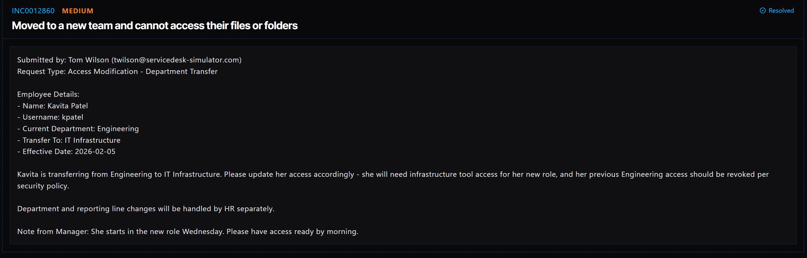

# Ticket 009: Updating Employee Access After Department Transfer

## Ticket Information
- **Platform:** ServiceDesk Simulator
- **Incident ID:** INC0012860
- **Status:** Resolved
- **Priority:** Medium
- **Ticket Type:** Account Management / Access Modification
- **Environment:** Simulated IT support environment
- **Submitted By:** Tom Wilson
- **Employee:** Kavita Patel
- **Username:** kpatel
- **Current Department:** Engineering
- **New Department:** IT Infrastructure
- **Effective Date:** February 5, 2026

## 1. Issue Summary

Tom Wilson submitted a request to update Kavita Patel's access because she was transferring from Engineering to IT Infrastructure.

Kavita needed access to the tools and resources used by her new team. At the same time, her previous Engineering access needed to be removed since she would no longer be working in that department.

The manager wanted everything ready before Kavita started her new role on Wednesday.

HR was responsible for updating her department information and reporting structure separately.

## 2. Business Impact

This ticket was marked Medium priority because Kavita needed the correct access permissions to begin working with her new team.

Without access to IT Infrastructure resources, she could experience delays when trying to complete her new responsibilities.

It was also important to remove her previous Engineering access so she wouldn't continue having permissions that were no longer needed for her role.

## 3. Troubleshooting Performed

1. **Opened the Directory:** Navigated to Tools → Directory in the ServiceDesk Simulator.

2. **Located the employee's account:** Searched for the username "kpatel" and selected Kavita Patel's account.

3. **Reviewed the access change:** The request required removing Kavita's Engineering group membership and adding her to the IT Infrastructure group.

4. **Removed previous access:** Removed Kavita from the Engineering group since she no longer needed access to those resources.

5. **Added new access:** Added Kavita to the IT Infrastructure group so she could access the resources associated with her new department.

## 4. Resolution

I updated Kavita's group memberships in the Directory to match her new role in IT Infrastructure.

I first removed her from the Engineering group to take away access that was no longer needed.

I then added her to the IT Infrastructure group so she would have the permissions required for her new position.

The changes were made in the ServiceDesk Simulator, and the ticket was marked Resolved.

## 5. Verification

**Account lookup:** Located Kavita's account using her username, kpatel.

**Previous access:** Removed the Engineering group membership.

**New access:** Added the IT Infrastructure group membership.

**Department update:** HR was responsible for updating Kavita's department and reporting information separately.

**Ticket status:** The ServiceDesk Simulator displayed the request as Resolved.

**Access testing:** A separate test confirming access to individual IT Infrastructure tools was not documented.

## 6. Technical Skills Demonstrated

- User account management
- Directory navigation and account lookup
- Security group membership management
- Adding and removing user permissions
- Role-based access control concepts
- Applying least-privilege security principles
- Managing access during employee transfers
- Following access modification requests
- IT security and account administration
- Service request documentation

## 7. Lessons Learned

This ticket helped me understand why updating user permissions is important when someone changes departments.

It wasn't just about giving Kavita access to her new team's resources. I also had to remove her old Engineering access so she wouldn't keep permissions she no longer needed.

I learned that group memberships can be used to manage access without having to change permissions for every individual resource.

It also showed me how IT and HR have different responsibilities during an employee transfer. HR handles the employee's department information, while IT makes sure their system access matches their new role.

## 8. Evidence

- Screenshot: 

## 9. Reflection

**What would I do differently or investigate further in a real-world IT environment?**

In a real IT environment, I would first confirm that the department transfer and access changes were approved by the appropriate manager.

I would also review Kavita's current permissions before making changes to make sure I understood which resources she could access.

After removing her Engineering group membership and adding her to IT Infrastructure, I would verify that she could access the applications, shared folders, and tools required for her new role.

I would also check whether any additional permissions were assigned directly to her account instead of through security groups.

Finally, I would document the changes and confirm that her old access had been removed according to the company's security policies.
