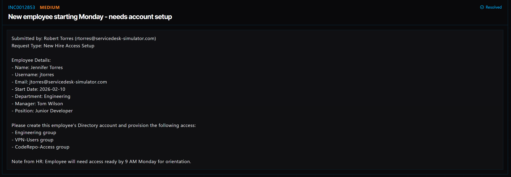

# Ticket 010: New Employee Account Setup and Access Provisioning

## Ticket Information
- **Platform:** ServiceDesk Simulator
- **Incident ID:** INC0012853
- **Status:** Resolved
- **Priority:** Medium
- **Ticket Type:** Account Management / New Hire Onboarding
- **Environment:** Simulated IT support environment
- **Submitted By:** Robert Torres
- **Employee:** Jennifer Torres
- **Username:** jtorres
- **Email:** jtorres@servicedesk-simulator.com
- **Department:** Engineering
- **Position:** Junior Developer
- **Manager:** Tom Wilson
- **Start Date:** February 10, 2026

## 1. Issue Summary

Robert Torres submitted a request to set up a new employee account for Jennifer Torres, who was joining the Engineering department as a Junior Developer.

Jennifer needed a Directory account and access to the systems and resources required for her new role.

The request included adding her to three groups: Engineering, VPN-Users, and CodeRepo-Access.

HR wanted her account and access ready by 9 AM on the requested onboarding day so she could participate in orientation and begin working without delays.

## 2. Business Impact

This ticket was marked Medium priority because Jennifer needed access to company systems before starting her new position.

Without an account and the correct permissions, she would not be able to access the resources needed for her work as a Junior Developer.

Completing the setup before orientation was important so she could start her new role without having to wait for IT to configure her account.

## 3. Troubleshooting Performed

1. **Opened the Directory:** Navigated to Tools → Directory in the ServiceDesk Simulator.

2. **Started creating the account:** Selected New User to begin setting up Jennifer's account.

3. **Entered the employee information:** Entered the username "jtorres" and the name Jennifer Torres.

4. **Created the user account:** Clicked Create User to add Jennifer to the Directory.

5. **Located the new account:** Searched for "jtorres" to find the account I had just created.

6. **Added Engineering access:** Added Jennifer to the Engineering group so she would have access to resources associated with her department.

7. **Added VPN access:** Added Jennifer to the VPN-Users group for the company's VPN access.

8. **Added code repository access:** Added Jennifer to the CodeRepo-Access group so she would have the permissions associated with the development team's code repositories.

## 4. Resolution

I created Jennifer's account in the Directory using the username jtorres.

After creating the account, I searched for her username and added her to the three groups requested for her new role.

The groups included Engineering, VPN-Users, and CodeRepo-Access.

Once the account was created and the group memberships were updated, the ticket was marked Resolved in the ServiceDesk Simulator.

## 5. Verification

**Account creation:** Created Jennifer Torres's Directory account using the username jtorres.

**Account lookup:** Searched for jtorres after creating the account.

**Engineering access:** Added Jennifer to the Engineering group.

**VPN access:** Added Jennifer to the VPN-Users group.

**Code repository access:** Added Jennifer to the CodeRepo-Access group.

**Ticket status:** The ServiceDesk Simulator displayed the request as Resolved.

**Login verification:** A successful first login and access test for each resource were not independently documented.

## 6. Technical Skills Demonstrated

- New employee onboarding
- User account creation
- Directory account management
- User provisioning
- Security group membership management
- Assigning access based on job responsibilities
- VPN access provisioning
- Code repository access management
- Role-based access control concepts
- Following employee onboarding requests
- Service request documentation

## 7. Lessons Learned

This ticket helped me understand what goes into setting up a new employee's account before their first day.

Creating the account was only one part of the process. I also had to make sure Jennifer was added to the correct groups so she would have access to the resources needed for her role.

I learned that group memberships make it easier to manage permissions because employees can be assigned access based on their department and job responsibilities.

It also showed me why completing onboarding requests on time is important. Having everything ready before an employee starts helps them get to work without unnecessary delays.

## 8. Evidence

- Screenshot: 

## 9. Reflection

**What would I do differently or investigate further in a real-world IT environment?**

In a real IT environment, I would first confirm that the onboarding request was approved and that the employee's information matched the records provided by HR.

I would also check whether the username was already in use before creating the account.

After creating Jennifer's account, I would verify that her group memberships were correct and that she could access the systems required for her role.

I would also check whether she needed additional setup, such as multifactor authentication, a company laptop, Microsoft 365 access, or other development tools.

Finally, I would make sure the account was ready before her start date and document the completed setup in the service request.
