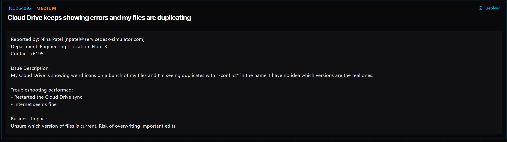

# Ticket 014: Cloud Drive Sync Errors and Duplicate Files

## Ticket Information
- **Platform:** ServiceDesk Simulator
- **Incident ID:** INC264892
- **Status:** Resolved
- **Priority:** Medium
- **Ticket Type:** Cloud Storage / File Synchronization
- **Environment:** Simulated IT support environment
- **Reported By:** Nina Patel
- **Email:** npatel@servicedesk-simulator.com
- **Department:** Engineering
- **Location:** Floor 3
- **Contact:** Extension 6195

## 1. Issue Summary

Nina Patel reported that her Cloud Drive was showing unusual icons on several files, along with duplicate files containing "-conflict" in their names.

She wasn't sure which files had the latest changes and was concerned about accidentally working with the wrong versions.

Before contacting IT, Nina had already tried restarting the Cloud Drive sync, but the issue continued. She also confirmed that her internet connection appeared to be working normally.

Since the files were showing synchronization conflicts, I needed to check the Cloud Drive application and make sure her files were syncing properly.

## 2. Business Impact

This ticket was marked Medium priority because Nina was having trouble identifying which versions of her files were current.

Since she works in Engineering, using an outdated file or accidentally overwriting important changes could affect her work.

Resolving the sync errors was important to help prevent file confusion and make sure she could continue working with the correct documents.

## 3. Troubleshooting Performed

1. **Connected to the user's computer:** Opened Tools → Remote Desktop and selected Connect next to Nina's PC.

2. **Opened Cloud Drive:** Once connected, opened the Cloud Drive application to check the synchronization issue.

3. **Started a manual sync:** Clicked Sync to force the application to synchronize the files again and clear the conflicts.

4. **Checked the files:** Opened File Explorer to review the files after the synchronization completed.

5. **Verified synchronization:** Confirmed that the files were syncing correctly and that the reported synchronization issue had been resolved.

## 4. Resolution

The issue was related to file synchronization conflicts in Cloud Drive.

I connected to Nina's computer through Remote Desktop and opened the Cloud Drive application.

I selected Sync to force the application to synchronize the files again.

After the sync completed, I opened File Explorer to make sure the files were showing correctly.

The synchronization issue was resolved, and the ServiceDesk Simulator marked the ticket as Resolved.

## 5. Verification

**Remote connection:** Connected to Nina's computer using Remote Desktop.

**Cloud Drive:** Opened the application and started a manual synchronization.

**Sync process:** Used the Sync option to refresh the files and address the conflicts.

**File Explorer:** Checked the files after synchronization to confirm they were syncing correctly.

**Ticket status:** The ServiceDesk Simulator displayed the incident as Resolved.

**File contents:** A separate comparison of the contents of conflicting file versions was not documented.

## 6. Technical Skills Demonstrated

- Remote desktop troubleshooting
- Cloud storage support
- File synchronization troubleshooting
- Identifying file sync conflicts
- Using cloud drive applications
- Manual file synchronization
- Windows File Explorer navigation
- Verifying synchronization status
- Understanding file version conflicts
- Incident documentation and resolution

## 7. Lessons Learned

This ticket helped me understand how cloud storage issues can cause confusion when files aren't syncing correctly.

Nina was seeing duplicate files with "-conflict" in their names and wasn't sure which versions were current.

Even though her internet was working, the Cloud Drive application was still having trouble synchronizing her files.

Running a manual sync helped resolve the issue.

I also learned that restarting an application doesn't always fix synchronization problems. Sometimes the application needs to run another sync to update the files properly.

## 8. Evidence

- Screenshot: 

## 9. Reflection

**What would I do differently or investigate further in a real-world IT environment?**

In a real IT environment, I would first check the Cloud Drive sync status and look for any error messages explaining why the files weren't synchronizing.

Since Nina mentioned duplicate files with "-conflict" in their names, I would be careful not to delete or overwrite anything before confirming which versions contained the latest changes.

I would compare the conflicting files, review their modification dates, and check version history if the cloud storage platform supported it.

I would also make sure the important files were backed up before attempting any changes that could affect their contents.

After resolving the issue, I would ask Nina to confirm that she could open her files and that the latest changes were still there.

Finally, I would document what caused the synchronization issue if I could identify it, especially if it was something that might affect other employees.
