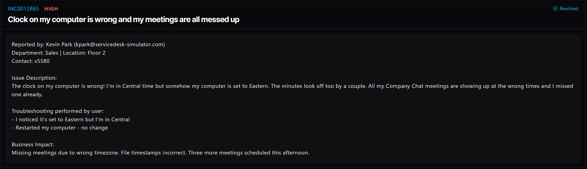

# Ticket 004: Computer Clock Showing the Wrong Time

## Ticket Information
- **Platform:** ServiceDesk Simulator
- **Incident ID:** INC0012865
- **Status:** Resolved
- **Priority:** High
- **Ticket Type:** System Configuration / Date & Time
- **Environment:** Simulated IT support environment
- **Reported By:** Kevin Park
- **Email:** kpark@servicedesk-simulator.com
- **Department:** Sales
- **Location:** Floor 2
- **Contact:** Extension 5580

## 1. Issue Summary

Kevin Park reported that the clock on his computer was showing the wrong time. Although he works in the Central Time Zone, his computer was set to Eastern Time. He also noticed that the minutes were slightly off.

Because of the incorrect time settings, his Company Chat meetings were showing up at the wrong times, and he had already missed one meeting.

Kevin had already restarted his computer, but that did not fix the problem.

## 2. Business Impact

This issue was marked High priority because the incorrect clock was affecting Kevin's work schedule.

He had already missed a meeting, and three more meetings were scheduled for that afternoon. Incorrect timestamps could also cause confusion when reviewing files and other work-related activity.

Getting the computer's time settings corrected was important so Kevin could stay on schedule and avoid missing additional meetings.

## 3. Troubleshooting Performed

1. **Connected to the user's computer:** Opened Tools → Remote Desktop and selected Connect next to Kevin's PC.
2. **Opened Windows settings:** Navigated to Settings → Time & Language.
3. **Checked the timezone:** Found that the computer was set to Eastern Time even though Kevin works in Central Time.
4. **Corrected the timezone:** Changed the timezone from Eastern to Central.
5. **Synchronized the clock:** Selected Sync Clock Now to correct the time difference.
6. **Verified the settings:** Checked that the computer was displaying the correct Central Time Zone and that the clock was showing the correct time.

## 4. Resolution

The issue was caused by the computer being configured for the wrong time zone.

I connected to Kevin's computer through the Remote Desktop tool and opened the Time & Language settings. I found that the computer was set to Eastern Time instead of Central Time.

I changed the timezone to Central and selected Sync Clock Now to correct the clock.

After making the changes, I checked the timezone and clock again to make sure both were correct. The issue was resolved, and the ticket was marked Resolved.

## 5. Verification

**Remote connection:** Successfully connected to Kevin's PC through the Remote Desktop tool.

**Timezone:** Changed the setting from Eastern Time to Central Time.

**Clock synchronization:** Selected Sync Clock Now to correct the time offset.

**Final check:** Confirmed that the timezone and computer clock were correct.

**Ticket status:** The ServiceDesk Simulator displayed the incident as Resolved.

## 6. Technical Skills Demonstrated

- Remote desktop support
- Windows Settings navigation
- Date and time configuration
- Timezone troubleshooting
- Clock synchronization
- Basic Windows system administration
- Identifying configuration issues
- Verifying system settings after making changes
- User support and incident documentation

## 7. Lessons Learned

This ticket helped me understand how something as simple as an incorrect time zone can affect an employee's daily work.

The computer was only one time zone off, but that was enough to cause problems with scheduled meetings and file timestamps.

I also learned that restarting a computer does not always fix configuration issues. Sometimes you have to go into the system settings, find what is configured incorrectly, and correct it manually.

## 8. Evidence

- Screenshot: 

## 9. Reflection

**What would I do differently or investigate further in a real-world IT environment?**

In a real IT environment, I would also check whether the computer is configured to synchronize its time automatically with the organization's approved time source.

If the clock continued to fall out of sync, I would investigate the Windows Time service and check for any domain time synchronization issues.

I would also ask Kevin to check his upcoming Company Chat meetings to make sure they are displaying at the correct times.

This would help confirm that correcting the computer's clock fixed the problem beyond just changing the timezone.
