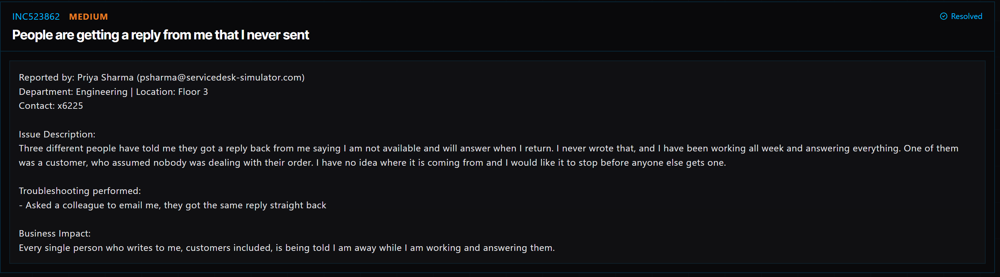

# Ticket 013: Unexpected Automatic Email Replies

## Ticket Information
- **Platform:** ServiceDesk Simulator
- **Incident ID:** INC523862
- **Status:** Resolved
- **Priority:** Medium
- **Ticket Type:** Email / Automatic Reply Configuration
- **Environment:** Simulated IT support environment
- **Reported By:** Priya Sharma
- **Email:** psharma@servicedesk-simulator.com
- **Department:** Engineering
- **Location:** Floor 3
- **Contact:** Extension 6225

## 1. Issue Summary

Priya Sharma reported that people were receiving automatic replies from her email account that she never remembered setting up.

Three people had contacted her about receiving a message saying she was unavailable and would respond when she returned. However, Priya had been working all week and responding to emails normally.

One of the people who received the message was a customer who thought nobody was handling their order.

Before contacting IT, Priya asked a coworker to send her a test email. The coworker received the same automatic reply immediately.

Since the message was being sent without Priya manually responding, I needed to check her email settings to find out what was causing it.

## 2. Business Impact

This ticket was marked Medium priority because the automatic replies were causing confusion for employees and customers trying to contact Priya.

Anyone who emailed her received a message saying she was unavailable, even though she was actively working.

This could lead customers to believe their requests or orders were not being handled.

Stopping the automatic replies was important to prevent further confusion and make sure people received accurate information.

## 3. Troubleshooting Performed

1. **Connected to the user's computer:** Opened Tools → Remote Desktop and selected Connect next to Priya's PC.

2. **Opened the email application:** Once connected, opened the Mail app to check her email settings.

3. **Reviewed the message list:** Noticed a message across the top of the inbox showing that automatic replies were enabled.

4. **Identified the problem:** The notice displayed the same reply that Priya's coworkers and customers had been receiving.

5. **Disabled automatic replies:** Turned off the automatic reply setting in the Mail application.

6. **Checked the inbox again:** Confirmed that the automatic reply notice was no longer showing.

7. **Requested another test:** Asked Priya to have the coworker who originally tested the issue send another email to confirm that the automatic response had stopped.

## 4. Resolution

The issue was caused by automatic replies being enabled in Priya's email account.

I connected to her computer through Remote Desktop and opened the Mail application.

At the top of the inbox, I found a notice showing that automatic replies were turned on. The message matched the response people had been receiving.

I disabled the automatic replies and checked the inbox again to make sure the notice disappeared.

I then asked Priya to have her coworker send another test email to verify that the automatic response was no longer being sent.

The ServiceDesk Simulator displayed the ticket as Resolved.

## 5. Verification

**Remote connection:** Connected to Priya's computer through Remote Desktop.

**Email application:** Opened the Mail app and reviewed the automatic reply notice.

**Automatic reply message:** Confirmed that the notice matched the message reported by Priya.

**Configuration change:** Disabled automatic replies.

**Settings verification:** Confirmed that the automatic reply notice disappeared from the inbox.

**Follow-up test:** Asked Priya to have her coworker send another email to check whether the issue was fixed.

**Ticket status:** The ServiceDesk Simulator displayed the incident as Resolved.

**Final email test:** The result of the coworker's second test was not independently documented in the provided steps.

## 6. Technical Skills Demonstrated

- Remote desktop troubleshooting
- Email application configuration
- Troubleshooting automatic email replies
- Identifying incorrect application settings
- Windows Mail application navigation
- Understanding email auto-response features
- Verifying configuration changes
- Supporting customer communication systems
- User communication and follow-up testing
- Incident documentation and resolution

## 7. Lessons Learned

This ticket helped me understand how a simple email setting can cause problems for someone who relies on email to communicate with coworkers and customers.

Priya thought messages were being sent from her account without her knowledge. After checking the Mail application, I found that automatic replies were enabled.

The notice at the top of the inbox helped me identify the issue without having to make unnecessary changes to her account.

I also learned why it's important to check application settings before assuming something more serious is happening.

Turning off automatic replies was a simple fix, but it made a difference because customers were receiving incorrect information about Priya's availability.

## 8. Evidence

- Screenshot: 

## 9. Reflection

**What would I do differently or investigate further in a real-world IT environment?**

In a real IT environment, I would first ask Priya when the automatic replies started and whether she remembered enabling an out-of-office message.

I would also check whether the automatic replies were configured in the email application or through the organization's email service, such as Microsoft 365 or Exchange Online.

After disabling the setting, I would have someone send another test email and confirm that no automatic response was received.

If the replies continued, I would investigate whether an inbox rule or another email configuration was responsible.

Since Priya mentioned that she never set up the message, I would also consider reviewing recent account activity if there were other signs of unauthorized changes.

Finally, I would document the setting that caused the problem and the steps taken to resolve it.
