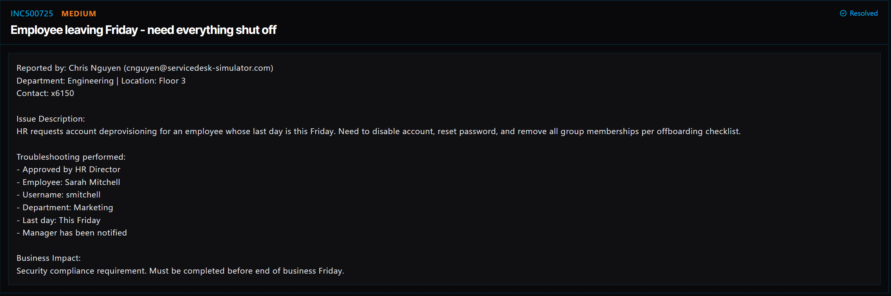

# Ticket 024: Employee Offboarding – Account Deprovisioning and Asset Recovery

## Ticket Information
- **Platform:** ServiceDesk Simulator
- **Incident ID:** INC500725
- **Status:** Resolved
- **Priority:** Medium
- **Ticket Type:** Employee Offboarding / Account Deprovisioning
- **Environment:** Simulated IT support environment
- **Reported By:** Chris Nguyen
- **Department of Requester:** Engineering
- **Location:** Floor 3
- **Contact:** Extension 6150
- **Employee Being Offboarded:** Sarah Mitchell
- **Username:** `smitchell`
- **Employee Department:** Marketing
- **Last Day:** Friday (date not specified)
- **Approval:** HR Director

## 1. Issue Summary

Chris Nguyen submitted a request to offboard Sarah Mitchell, an employee in Marketing whose last day was Friday. HR had already approved the request, and Sarah's manager had been notified.

The offboarding checklist called for disabling her account, resetting her password, removing licenses and unnecessary group memberships, and recovering her company device. I needed to complete those steps without deleting the account so the organization could retain its records.

## 2. Business Impact

This ticket was marked Medium priority, but it had a firm deadline: the offboarding needed to be completed by the end of business Friday.

Leaving an account active after an employee's departure could allow access to company systems and information that the person no longer needs. Recovering the device and removing unused licenses also help the company keep track of its equipment and resources.

## 3. Troubleshooting and Actions Performed

1. **Located the employee account:** Opened Tools → Directory and searched for `smitchell` to find Sarah Mitchell.
2. **Disabled the account:** Disabled Sarah's account rather than deleting it, following the offboarding instructions.
3. **Reset the password:** Reset the account password as an additional step to prevent use of the old credentials.
4. **Removed assigned licenses:** Removed the account's licenses, including Office Suite and any other assigned licenses.
5. **Updated group memberships:** Removed Sarah from all groups except **Domain Users**, as required by the simulator's checklist.
6. **Located the assigned device:** Opened Asset Management and searched for `smitchell` to find Sarah's equipment.
7. **Processed the device return:** Followed the asset return workflow and included a return label.
8. **Checked completion:** Confirmed that the account was deprovisioned and the device was listed as back in stock in the simulator.

## 4. Resolution

I completed the offboarding steps for Sarah Mitchell in the ServiceDesk Simulator.

I disabled her Directory account, reset the password, removed assigned licenses, and cleared group memberships other than Domain Users. I then used Asset Management to process the return of her assigned device with a return label.

The simulator showed the account as deprovisioned and the device back in stock. The ticket displayed a **Resolved** status.

## 5. Verification

**Account status:** Confirmed Sarah's account was disabled, not deleted.

**Password:** Completed the password reset.

**Licenses:** Removed the account's assigned licenses.

**Group memberships:** Removed all memberships except Domain Users, following the simulator's instructions.

**Asset recovery:** Completed the device return workflow with a return label and confirmed the device was marked back in stock.

**Ticket status:** ServiceDesk Simulator displayed the ticket as Resolved.

**Real-world timing:** The screenshot does not provide an exact offboarding date or time, so completion before the actual departure deadline cannot be independently established from the screenshot alone.

## 6. Technical Skills Demonstrated

- User account deprovisioning
- Directory account administration
- Disabling accounts without deleting records
- Password resets
- Software license removal
- Security group membership management
- Following an HR-approved offboarding process
- IT asset tracking and device return workflows
- Access control and security compliance awareness
- Documenting and verifying completed service requests

## 7. Lessons Learned

This ticket helped me understand that offboarding involves more than just disabling someone's login.

I had to look at the account, its licenses, its group memberships, and the equipment assigned to the employee. Missing one of those steps could leave unnecessary access in place or make it harder to track company assets.

I also learned why disabling an account is different from deleting it. Keeping the account record can be important for company records and follow-up work, while disabling it prevents normal sign-in.

The biggest takeaway for me was that even a routine employee departure needs a clear checklist and careful verification.

## 8. Evidence

- Screenshot: 

## 9. Reflection

**What would I do differently or investigate further in a real-world IT environment?**

In a real IT environment, I would confirm the employee's last working day, exact cutoff time, and HR approval before making changes. I would coordinate the timing so access wasn't removed too early or left active after departure.

I would also check for active sessions, VPN access, MFA methods, cloud applications, shared mailboxes, and any access outside the main Directory. Depending on company policy, I would revoke sessions and remove access across connected systems.

Before removing licenses or making changes to the mailbox and files, I would check the organization's retention and legal-hold requirements. I would also coordinate with HR and the manager about transferring business-owned files or responsibilities.

For the device, I would track the return label, shipment, receipt, and physical inspection before treating the asset as available for reassignment. If the device were to be reused, it would need the company's approved data-wipe and reimaging process.

Finally, I would document each completed action and confirm the offboarding checklist was fully satisfied before closing the request.
