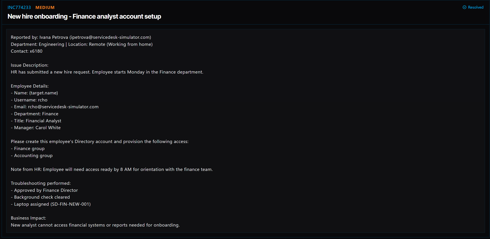

# Ticket 025: New Hire Onboarding – Finance Analyst Account Setup

## Ticket Information
- **Ticket ID:** INC774233
- **Platform:** ServiceDesk Simulator
- **Status:** Resolved
- **Priority:** Medium
- **Ticket Type:** New Hire Onboarding / User Account Setup
- **Environment:** Simulated IT support environment
- **Requested by:** Ivana Petrova (Engineering)
- **New employee username:** `rcho`
- **Department:** Finance
- **Job title:** Financial Analyst
- **Manager:** Carol White
- **Assigned laptop:** SD-FIN-NEW-001

## 1. Issue Summary
HR submitted a request to set up a new Financial Analyst before their first day on Monday. The employee needed a Directory account and access to the Finance and Accounting groups so they could get started with their work.

The request listed the username as `rcho` and the email address as `rcho@servicedesk-simulator.com`. The employee's name appeared as `{target.name}` in the simulator, so I have kept that placeholder rather than guessing a name.

## 2. Business Impact
The new hire needed access ready by **8 AM on Monday** for orientation with the Finance team. Without the account and the correct group memberships, they would not be able to access the financial systems and reports needed for onboarding.

The request was already approved by the Finance Director, the background check was cleared, and a laptop had been assigned.

## 3. Troubleshooting and Setup Performed
1. Opened **Tools → Directory** in ServiceDesk Simulator.
2. Clicked **New user** to start creating the employee's account.
3. Entered `rcho` as the username and used the display name provided in the request (`{target.name}`).
4. Set the employee's department to **Finance**.
5. Clicked **Create User** to save the new account.
6. Searched the Directory for `rcho` to find the account I had just created.
7. Added the employee to the **Finance** group.
8. Added the employee to the **Accounting** group.

## 4. Resolution
I created the new employee's Directory account and assigned the two requested groups: Finance and Accounting. This completed the account setup steps provided in the simulator, and the ticket showed a **Resolved** status.

## 5. Verification
- **Account setup:** The `rcho` account was created in the Directory.
- **Group access:** Finance and Accounting were the two groups assigned during setup.
- **Ticket status:** The simulator displayed the ticket as **Resolved**.
- **First-day sign-in:** A successful login by the new employee was not separately documented.

## 6. Technical Skills Demonstrated
- Creating user accounts in a directory
- Updating user profile information
- Assigning access through security groups
- Following an approved employee onboarding request
- Understanding role-based access and least-privilege principles
- Documenting account provisioning work

## 7. Lessons Learned
Setting up a new employee involves more than just creating a username. I also need to make sure the account has the right department information and group memberships so the employee can access what they need on day one.

I also learned to double-check the information provided in a ticket. In this case, the employee's name showed up as a placeholder, so in a real workplace I would confirm the correct legal or display name with HR before finalizing the account.

## 8. Evidence
- Screenshot: 

## 9. Reflection
In a real IT environment, I would confirm the employee's identity details and start date with HR, verify that the requested groups match the employee's job duties, and check whether any additional approvals or licenses are needed. I would also coordinate laptop delivery and have the employee confirm they can sign in and access the required Finance resources on their first day.
