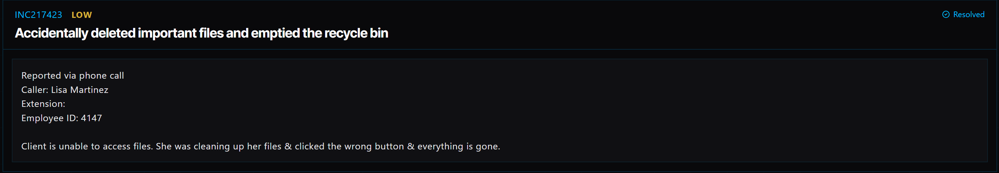

# Ticket 016: Recovering Accidentally Deleted Files

## Ticket Information
- **Platform:** ServiceDesk Simulator
- **Incident ID:** INC217423
- **Status:** Resolved
- **Priority:** Low
- **Ticket Type:** File Recovery / Cloud Storage
- **Environment:** Simulated IT support environment
- **Reported By:** Lisa Martinez
- **Reported Via:** Phone Call
- **Employee ID:** 4147
- **Issue:** Accidentally deleted files and emptied the Recycle Bin

## 1. Issue Summary

Lisa Martinez contacted IT because she accidentally deleted some important files while cleaning up her computer.

She explained that she clicked the wrong option while organizing her files and ended up deleting information she still needed.

She had also emptied the Recycle Bin, so she couldn't restore the files using the normal Windows recovery option.

Since the files were no longer showing in File Explorer, I needed to check whether they could still be recovered through Cloud Drive.

## 2. Business Impact

This ticket was marked Low priority in the ServiceDesk Simulator.

Lisa was unable to access files she needed, which could interrupt her work depending on what information was deleted.

Even though the ticket was marked Low priority, recovering the files was important because losing important documents could lead to additional work or delays.

## 3. Troubleshooting Performed

1. **Connected to the user's computer:** Opened Tools → Remote Desktop and selected Connect next to Lisa's PC.

2. **Checked File Explorer:** Opened File Explorer and confirmed that the deleted files were no longer showing.

3. **Opened Cloud Drive:** Launched the Cloud Drive application to check whether the missing files could be recovered.

4. **Synchronized the files:** Clicked Sync to pull the latest file information from Cloud Drive.

5. **Checked version history:** Navigated to Cloud Drive → Version History.

6. **Located recently deleted files:** Opened Recently Deleted Files to look for the missing folder.

7. **Restored the deleted folder:** Selected the deleted folder and used the Restore option to recover it.

8. **Verified the recovery:** Checked the recovered files to confirm they were available and intact.

## 4. Resolution

The issue was resolved by recovering Lisa's deleted folder through Cloud Drive.

After connecting to her computer, I confirmed that the files were missing from File Explorer.

I opened Cloud Drive and ran a sync to update the file information.

I then went to Version History and opened Recently Deleted Files, where I located the deleted folder.

I restored the folder and checked that the recovered files were intact.

The ServiceDesk Simulator displayed the ticket as Resolved.

## 5. Verification

**Remote connection:** Connected to Lisa's computer using Remote Desktop.

**File Explorer:** Confirmed that the files were missing before starting the recovery process.

**Cloud Drive synchronization:** Ran Sync to retrieve the latest file information.

**Recently deleted files:** Located the deleted folder under Cloud Drive → Version History → Recently Deleted Files.

**File restoration:** Restored the deleted folder.

**File integrity:** Confirmed that the recovered files were intact.

**Ticket status:** The ServiceDesk Simulator displayed the incident as Resolved.

## 6. Technical Skills Demonstrated

- Remote desktop troubleshooting
- File recovery and restoration
- Cloud storage management
- Cloud Drive synchronization
- Navigating file version history
- Recovering deleted folders
- Windows File Explorer navigation
- Verifying file integrity after recovery
- Basic data protection and recovery concepts
- Incident documentation and resolution

## 7. Lessons Learned

This ticket helped me understand that deleting files from a computer doesn't always mean they're permanently gone.

Lisa had already emptied the Recycle Bin, so restoring the files through Windows wasn't an option anymore.

Instead of assuming the files were lost, I checked Cloud Drive to see whether there was another way to recover them.

I learned that cloud storage services may keep deleted files for a certain amount of time, even after they're removed from the computer.

Using the Recently Deleted Files feature allowed me to restore Lisa's folder without having to recreate the missing documents.

This also showed me why it's important to check available recovery options before telling someone their files cannot be recovered.

## 8. Evidence

- Screenshot: 

## 9. Reflection

**What would I do differently or investigate further in a real-world IT environment?**

In a real IT environment, I would first ask Lisa which files or folders were deleted and when the deletion happened.

I would also check whether the files were stored locally, on a shared network drive, or in a cloud storage service.

Before attempting recovery, I would avoid making unnecessary changes that could affect the chances of restoring the files.

If the files were stored in a service such as OneDrive or SharePoint, I would check the Recycle Bin, version history, and any available recovery options.

After restoring the files, I would ask Lisa to open a few important documents to confirm that the correct versions were recovered.

I would also explain how to check the Recycle Bin and cloud recovery options if something similar happened again.

Finally, I would document the recovery steps and confirm that the restored files were available in their original location.
