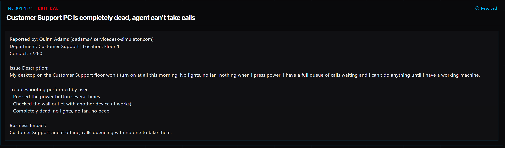

# Ticket 002: Customer Support Desktop Will Not Turn On

## Ticket Information
- **Platform:** ServiceDesk Simulator
- **Status:** Replacement Deployment Required
- **Priority:** High
- **Ticket Type:** Hardware / Desktop Power Issue
- **Environment:** Simulated IT support environment
- **Reported By:** Quinn Adams
- **Email:** qadams@servicedesk-simulator.com
- **Department:** Customer Support
- **Location:** Floor 1
- **Contact:** Extension 2280

## 1. Issue Summary

Quinn Adams reported that their desktop would not turn on when they arrived at work. Pressing the power button did nothing. There were no lights, fan activity, or sounds coming from the computer.

The agent had already tried pressing the power button several times and testing the wall outlet with another device. Since the outlet was working, I needed to rule out the power cable before moving forward with a replacement.

## 2. Business Impact

This issue was marked High priority because Quinn works in Customer Support and could not access their workstation.

They had a full queue of calls waiting, but without a working computer, they were unable to assist customers. Leaving the issue unresolved could also increase customer wait times.

Getting a replacement computer to the agent as quickly as possible was important to getting them back to work.

## 3. Troubleshooting Performed

1. **Checked the power source:** Contacted Quinn through Company Chat and asked them to try a known-working outlet and a different power cable.
2. **Confirmed the computer was unresponsive:** Even after trying another outlet and power cable, the desktop showed no lights or fan activity.
3. **Determined a replacement was needed:** Since the computer still would not power on, I moved forward with the replacement process.
4. **Confirmed the computer type:** Messaged Quinn through Company Chat to verify that the original machine was a desktop. This helped ensure the replacement would be the correct type.

## 4. Resolution

After confirming that the desktop was still unresponsive, I used the ServiceDesk Simulator to build and ship a replacement computer.

### Building the Replacement Computer

1. Opened **Tools → Computer Deployment**.
2. Selected **Server Imaging** to build the replacement.
3. Checked **Documentation → Hardware & Assets → Choosing a PC Setup** to make sure I was using the correct setup method. Customer Support agents require Server Imaging rather than Cloud Provisioning.
4. Completed the build and confirmed that the replacement computer was available on the PC Shelf.

### Shipping the Replacement

5. Contacted Quinn through Company Chat and requested the site's receiving dock address. Since Quinn works on-site, the computer needed to go to the workplace instead of their home.
6. Opened **Tools → Ship Manager**.
7. Kept Quinn as the recipient and entered the receiving dock address.
8. Under **Select a computer to ship**, selected the replacement desktop.
9. Checked **Include return label** so the original computer could be sent back.
10. Left the shipping speed set to **Rush Priority (Instant)**.
11. Selected **Ship** to send the replacement.

### Returning the Original Computer

Once the replacement arrives, Quinn will use the prepaid return label to send the defective desktop back.

## 5. Verification

- **Power check:** Quinn tested another outlet and a different power cable, but the desktop still would not turn on.
- **Replacement build:** The replacement was built using Server Imaging, as required for Customer Support.
- **Shipping address:** The site's receiving dock address was entered instead of the employee's home address.
- **Return label:** A prepaid return label was included with the shipment.
- **Shipping speed:** Rush Priority (Instant) was selected.
- **Final verification:** The replacement still needs to be delivered and tested to confirm that Quinn can log in and resume taking calls.
- **Equipment return:** The original desktop still needs to be returned using the prepaid label.

## 6. Technical Skills Demonstrated

- Basic desktop hardware troubleshooting
- Checking power sources and power cables
- Identifying when a computer needs replacement
- Building and imaging replacement computers
- Following hardware deployment documentation
- Using computer deployment and shipping tools
- Coordinating equipment delivery and returns
- Communicating with users through Company Chat
- Prioritizing issues based on business impact

## 7. Lessons Learned

This ticket showed me the importance of checking the simple things before deciding that a computer needs to be replaced. Testing another outlet and power cable helped rule out some basic power issues.

I also learned that deploying a replacement computer involves more than just building the machine. You have to select the correct setup method, confirm the employee's device type, make sure the equipment goes to the right location, and include a return label for the defective computer.

## 8. Evidence

- Screenshot: 

## 9. Reflection

**What would I do differently or investigate further in a real-world IT environment?**

In a real IT environment, I would record the original computer's asset tag, serial number, and hardware specifications before arranging the replacement.

Once the replacement arrived, I would make sure it powers on, verify that the imaging process completed correctly, and confirm that Quinn can log in and access the tools needed for Customer Support.

I would also follow up on the return shipment and make sure the equipment inventory was updated so the organization has an accurate record of the replacement.is required.

Potential areas to investigate include:
- Power cable connections and condition.
- Power supply unit (PSU).
- Desktop power button and internal connections.
- Motherboard or other internal hardware components.

These are potential causes and have not yet been confirmed.

## 5. Verification

**Power source:** The user tested the wall outlet with another device and confirmed that it works.

**Power button:** Multiple attempts to power on the desktop were unsuccessful.

**System response:** No lights, fan movement, or audible beeps were observed.

**Post-repair verification:** A successful power-on and workstation login have not yet been documented.

**Ticket status:** Keep the ticket open until the desktop is operational and the employee can resume work.

## 6. Technical Skills Demonstrated

- Hardware troubleshooting and initial diagnostics
- Desktop power failure investigation
- Identifying potential power supply issues
- Basic electrical outlet verification
- Incident prioritization based on business impact
- User communication and incident documentation
- Identifying when hardware escalation is necessary

## 7. Lessons Learned

When a desktop shows no signs of power, it is important to determine whether the issue originates from the electrical source, power cable, power supply, or internal hardware.

Verifying the wall outlet is a useful first step because it helps eliminate one possible cause before investigating the computer itself.
