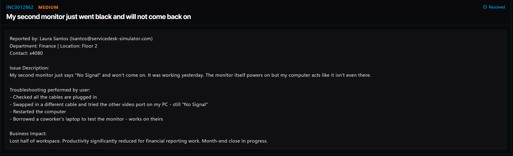

# Ticket 005: Second Monitor Showing No Signal

## Ticket Information
- **Platform:** ServiceDesk Simulator
- **Incident ID:** INC0012862
- **Status:** Resolved
- **Priority:** Medium
- **Ticket Type:** Hardware / Display Troubleshooting
- **Environment:** Simulated IT support environment
- **Reported By:** Laura Santos
- **Email:** santos@servicedesk-simulator.com
- **Department:** Finance
- **Location:** Floor 2
- **Contact:** Extension 4080

## 1. Issue Summary

Laura Santos reported that her second monitor suddenly stopped working. The monitor powered on, but displayed a "No Signal" message and was not receiving a display from her computer.

She mentioned that everything had been working the previous day. Before contacting IT, Laura checked the cables, tried a different cable and video port, and restarted her computer. She also connected the monitor to a coworker's laptop, where it worked without any issues.

Since the monitor worked with another computer, the problem appeared to be related to her PC rather than the monitor itself.

## 2. Business Impact

This issue was assigned Medium priority because Laura lost half of her workspace and could no longer use her dual-monitor setup.

As a Finance employee, she relies on multiple screens to work with financial reports and spreadsheets. With month-end closing in progress, losing a monitor was making it harder to complete her work efficiently.

## 3. Troubleshooting Performed

1. **Connected remotely to the computer:** Opened Tools → Remote Desktop and selected Connect next to Laura's PC.
2. **Opened System Update:** Once connected, opened the System Update app to check for available updates.
3. **Checked for updates:** Ran an update check and found an available graphics driver update.
4. **Installed the updates:** Installed all available updates, including the graphics driver.
5. **Restarted the computer:** Restarted Laura's PC so the updates could take effect.
6. **Tested the second monitor:** After the restart, confirmed that the second monitor was working again.

## 4. Resolution

The issue was related to an outdated graphics driver.

I connected to Laura's computer through Remote Desktop and opened the System Update app. After checking for available updates, I found a graphics driver update.

I installed all available updates and restarted the computer to apply the changes.

After the restart, the second monitor was working again, and Laura was able to use her dual-monitor setup. The ticket was marked Resolved.

## 5. Verification

**Initial checks:** Laura had already checked the cables, tried another video cable and port, restarted the computer, and tested the monitor with a coworker's laptop.

**Remote connection:** Successfully connected to Laura's PC through Remote Desktop.

**Graphics driver:** Found and installed the available graphics driver update.

**System restart:** Restarted the computer to apply the updates.

**Monitor functionality:** Confirmed that the second monitor was working after the restart.

**Ticket status:** The ServiceDesk Simulator displayed the incident as Resolved.

## 6. Technical Skills Demonstrated

- Remote desktop support
- Display and monitor troubleshooting
- Windows graphics driver updates
- Using system update tools
- Installing device drivers
- Restarting a computer to apply updates
- Identifying possible driver-related issues
- Verifying hardware functionality after troubleshooting
- Incident documentation and resolution

## 7. Lessons Learned

This ticket helped me understand that not every monitor issue is caused by faulty hardware or loose cables.

Laura had already checked the connections and tested the monitor with another computer. Since the monitor worked on her coworker's laptop, it made sense to investigate the computer's display configuration and graphics driver.

Finding and installing the graphics driver update resolved the issue. It was a good reminder to consider software and driver problems when troubleshooting hardware that appears to be malfunctioning.

## 8. Evidence

- Screenshot: 

## 9. Reflection

**What would I do differently or investigate further in a real-world IT environment?**

In a real IT environment, I would check the graphics adapter and driver version in Device Manager before installing updates. I would also review the update history to see whether a recent driver change might have caused the problem.

After installing the update, I would verify that both monitors are detected correctly and that the display settings are configured properly.

I would also ask Laura to confirm that she can comfortably use both screens for her financial reporting work, especially while month-end closing is underway.
