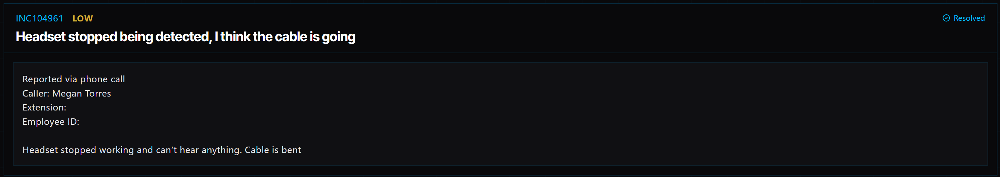

# Ticket 012: Headset Not Detected by Computer

## Ticket Information
- **Platform:** ServiceDesk Simulator
- **Incident ID:** INC104961
- **Status:** Resolved
- **Priority:** Low
- **Ticket Type:** Hardware / Device Driver Issue
- **Environment:** Simulated IT support environment
- **Reported By:** Megan Torres
- **Reported Via:** Phone Call
- **Issue:** Headset not detected by computer

## 1. Issue Summary

Megan Torres called IT because her headset had stopped working. She couldn't hear anything through it, and her computer was no longer detecting the device.

She mentioned that the headset cable was bent and thought that might be causing the problem.

Since the headset wasn't being recognized by the computer, I needed to check whether the issue was related to the hardware or something within Windows.

## 2. Business Impact

This ticket was marked Low priority in the ServiceDesk Simulator.

Megan was unable to use her headset, which could make it difficult to participate in calls or other activities that require audio.

Although she suspected a damaged cable, I wanted to check the computer for any errors before deciding whether the headset needed to be replaced.

## 3. Troubleshooting Performed

1. **Connected to the user's computer:** Opened Tools → Remote Desktop and selected Connect next to Megan's PC.

2. **Checked Event Viewer:** Opened Event Viewer from the Start menu and reviewed the System log for errors related to the headset.

3. **Found a driver error:** The logs showed that the headset driver had been failing to load during startup since a recent update was installed.

4. **Ruled out the suspected cable issue:** Since Windows was reporting repeated driver loading failures, the evidence pointed toward a software issue rather than the bent cable Megan mentioned.

5. **Opened Device Manager:** Used the taskbar search to open Device Manager and check how Windows was recognizing the headset.

6. **Located the headset:** Found the headset listed under Other devices with a warning symbol, indicating that Windows was having trouble with the device.

7. **Identified the headset model:** Used the device information in Device Manager to identify the correct headset model.

8. **Searched for the correct driver:** Opened the web browser and searched for the headset model along with "drivers download."

9. **Located the manufacturer's website:** Made sure I was using the manufacturer's official website rather than a third-party driver download site.

10. **Installed the driver:** Downloaded and ran the driver installer for the headset.

11. **Restarted the computer:** Restarted Megan's PC so the driver installation could take effect.

12. **Completed the restart process:** The computer returned to the login screen. The simulator's workflow called for signing back in to finish the setup.

## 4. Resolution

The issue was related to the headset driver failing to load after a system update.

I connected to Megan's computer through Remote Desktop and checked Event Viewer, where I found repeated driver errors.

I then opened Device Manager and found the headset listed under Other devices with a warning symbol.

After identifying the headset model, I located the correct driver on the manufacturer's official website and installed it.

I restarted the computer to apply the changes.

The ServiceDesk Simulator displayed the ticket as Resolved.

The troubleshooting showed that replacing the headset was not necessary based on the driver errors found.

## 5. Verification

**Remote connection:** Connected to Megan's computer using Remote Desktop.

**Event Viewer:** Found repeated headset driver loading failures in the System log.

**Device Manager:** Located the headset under Other devices with a warning symbol.

**Driver source:** Used the manufacturer's official website to obtain the driver.

**Driver installation:** Installed the appropriate headset driver.

**System restart:** Restarted the computer to apply the driver installation.

**Ticket status:** The ServiceDesk Simulator displayed the incident as Resolved.

**Audio test:** A separate test confirming that Megan could hear audio through the headset was not documented in the provided steps.

## 6. Technical Skills Demonstrated

- Remote desktop troubleshooting
- Windows Event Viewer
- Reviewing Windows System logs
- Windows Device Manager
- Identifying device driver errors
- Troubleshooting hardware and software issues
- Finding device drivers using hardware model information
- Downloading drivers from official manufacturer websites
- Installing and updating device drivers
- Windows restart and recovery procedures
- Incident documentation and resolution

## 7. Lessons Learned

This ticket taught me that a hardware problem isn't always what it seems.

Megan thought her headset stopped working because the cable was bent. At first, that sounded like a possible cause, but checking Event Viewer gave me a better idea of what was happening.

The logs showed that the headset driver had been failing since an update. When I checked Device Manager, the warning symbol supported what I found in Event Viewer.

Instead of immediately replacing the headset, I was able to focus on fixing the driver.

I also learned why it's important to download drivers from the manufacturer's official website. Using the correct driver helps avoid compatibility problems and reduces the risk of downloading unsafe software.

## 8. Evidence

- Screenshot: 

## 9. Reflection

**What would I do differently or investigate further in a real-world IT environment?**

In a real IT environment, I would start by checking whether the headset was physically damaged, but I wouldn't assume the bent cable was the cause without investigating further.

I would review Event Viewer and Device Manager to see whether Windows was reporting any errors.

Before installing a new driver, I would also check whether the recent update caused a compatibility issue and whether rolling back the driver was an option.

I would make sure the driver came from an approved manufacturer source and followed the company's software installation procedures.

After restarting the computer, I would ask Megan to test the headset and confirm that she could hear audio again.

I would also check that the headset appeared correctly in Device Manager without any warning symbols.

Finally, I would document the driver version and the steps taken so the information could help if another employee experienced the same issue.
