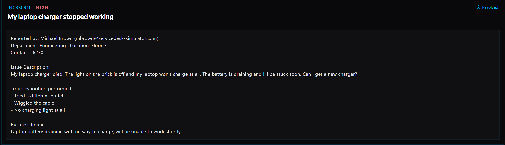

# Ticket 015: Laptop Charger Stopped Working

## Ticket Information
- **Platform:** ServiceDesk Simulator
- **Incident ID:** INC330910
- **Status:** Resolved
- **Priority:** High
- **Ticket Type:** Hardware / Laptop Charger Replacement
- **Environment:** Simulated IT support environment
- **Reported By:** Michael Brown
- **Email:** mbrown@servicedesk-simulator.com
- **Department:** Engineering
- **Location:** Floor 3
- **Contact:** Extension 6270

## 1. Issue Summary

Michael Brown reported that his laptop charger had stopped working. The light on the charging brick was no longer turning on, and his laptop wasn't charging.

He mentioned that his laptop was still running on battery power, but the battery was draining.

Before contacting IT, Michael had already tried plugging the charger into a different outlet and adjusting the cable, but neither attempt worked.

Since the laptop was still running on battery power, I needed to confirm whether the problem was with the charger before arranging a replacement.

## 2. Business Impact

This ticket was marked High priority because Michael's laptop battery was running low, and he had no way to charge it.

Since he works in Engineering, losing access to his laptop could interrupt his work and prevent him from completing his tasks.

Getting a replacement charger to him quickly was important so he could continue working without losing access to his computer.

## 3. Troubleshooting Performed

1. **Contacted the user:** Reached out to Michael through Company Chat to confirm what was happening with his laptop charger.

2. **Checked the charging issue:** Confirmed that the charger had no indicator light and that the laptop was still running on battery power.

3. **Reviewed previous troubleshooting:** Michael had already tried another electrical outlet and adjusting the charging cable without success.

4. **Determined a replacement was needed:** Based on the symptoms and troubleshooting results, I moved forward with replacing the charger.

5. **Requested shipping information:** Contacted Michael through Company Chat and asked for his shipping address so the replacement could be delivered.

## 4. Resolution

After confirming that the charger was not working, I arranged for a replacement through the ServiceDesk Simulator.

### Shipping the Replacement Charger

1. Opened **Tools → Ship Manager**.

2. Entered the shipping address Michael provided through Company Chat.

3. Selected **Laptop Charger** as the replacement item.

4. Set the shipping speed to **Rush Priority (Instant)** because Michael's laptop battery was draining.

5. Clicked **Ship** to send the replacement charger.

### Confirming the Replacement

6. Once the replacement arrived, I asked Michael to plug it into his laptop.

7. Michael confirmed that the laptop was charging again.

8. With charging restored, the ticket was marked Resolved.

## 5. Verification

**Initial power check:** The original charger had no indicator light, and the laptop was not charging.

**Outlet testing:** Michael had already tried a different electrical outlet without success.

**Laptop functionality:** The laptop was still working on battery power.

**Replacement item:** Selected Laptop Charger in Ship Manager.

**Shipping speed:** Used Rush Priority (Instant).

**Charging test:** Michael connected the replacement charger and confirmed that the laptop was charging.

**Ticket status:** The ServiceDesk Simulator displayed the incident as Resolved.

## 6. Technical Skills Demonstrated

- Basic laptop hardware troubleshooting
- Identifying power and charging issues
- Troubleshooting laptop power adapters
- Determining when hardware replacement is needed
- Coordinating replacement equipment
- Using IT shipping and asset management tools
- Prioritizing incidents based on business impact
- Communicating with users through Company Chat
- Confirming hardware functionality after replacement
- Incident documentation and resolution

## 7. Lessons Learned

This ticket helped me understand the importance of checking basic power issues before replacing equipment.

Michael had already tried another outlet and adjusting the cable, but his laptop still wouldn't charge. Since the laptop was working on battery power and the charger showed no signs of power, replacing the charger was the next step.

I also learned that resolving a hardware issue doesn't always mean repairing the equipment itself. Sometimes the best solution is to provide a replacement so the employee can get back to work.

Following up with Michael after the charger arrived was important because it confirmed that the replacement actually fixed the problem.

## 8. Evidence

- Screenshot: 

## 9. Reflection

**What would I do differently or investigate further in a real-world IT environment?**

In a real IT environment, I would first check the laptop model and the charger's specifications to make sure the replacement was compatible.

I would also inspect the charging port for visible damage and, if available, test the laptop with a known-working compatible charger before ordering a replacement.

Since Michael's battery was draining, I would look into whether a spare charger was available on-site so he wouldn't have to wait for shipping.

After receiving the replacement, I would ask him to confirm that the laptop was charging normally and that the battery percentage was increasing.

I would also document the replacement in the company's equipment records and follow the proper process for returning or disposing of the defective charger.
