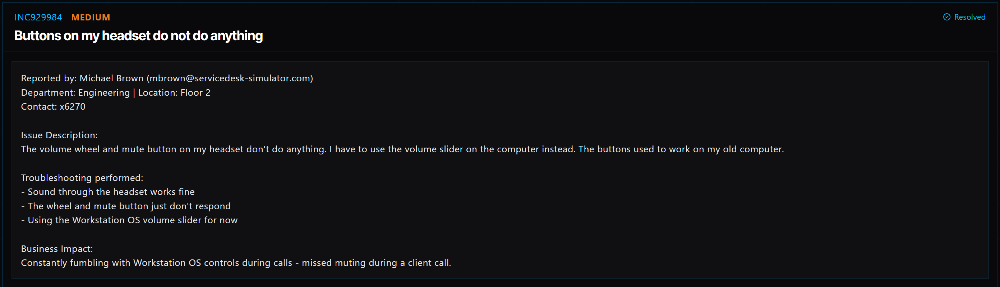

# Ticket 026: Headset Volume and Mute Buttons Not Working

## Ticket Information
- **Ticket ID:** INC929984
- **Platform:** ServiceDesk Simulator
- **Status:** Resolved (as shown in simulator)
- **Priority:** Medium
- **Ticket Type:** Hardware / Peripheral Driver Issue
- **Environment:** Simulated IT support environment
- **Reported by:** Michael Brown (mbrown@servicedesk-simulator.com)
- **Department:** Engineering
- **Location:** Floor 2
- **Contact:** x6270

## 1. Issue Summary
Michael reported that the volume wheel and mute button on his headset stopped responding. He could still hear audio normally, but he had to adjust the volume through the computer instead of using the headset controls. He mentioned that the buttons worked on his previous computer, which suggested the issue might be related to the setup on his current PC rather than a broken headset.

## 2. Business Impact
The headset still played sound, but not being able to mute or adjust volume quickly made calls harder to manage. Michael had already missed muting during a client call, so getting the controls working again was important.

## 3. Troubleshooting Performed
1. Opened **Tools → Remote Desktop** and selected **Connect** next to Michael's PC.
2. Searched for and opened **Device Manager**. The headset appeared under **Other devices** with a warning symbol, and its entry showed the model needed to find the correct driver.
3. Opened the web browser and searched for the headset model followed by **drivers download**.
4. Went to the **manufacturer's official website** and checked the domain before downloading anything. I avoided ads and third-party driver download sites.
5. Downloaded and ran the driver installer for the headset.
6. Restarted the computer so the driver changes could take effect.
7. After the computer returned to the login screen, followed the simulator's Company Chat workflow to complete the sign-in and finish the support session.

## 4. Resolution
The issue was addressed by installing the correct headset driver and restarting the computer. Since the headset was producing sound but its physical controls were not responding, checking Device Manager helped narrow the problem down to missing or improperly installed device support rather than an audio-output failure.

The simulator shows this ticket as **Resolved**.

## 5. Verification
- **Driver issue identified:** Device Manager showed the headset under **Other devices** with a warning symbol.
- **Correct driver source:** The installation steps used the manufacturer's official website.
- **Restart:** The computer was restarted after driver installation.
- **Ticket status:** The simulator displays **Resolved**.
- **Functional test:** The provided steps do not separately document a test of the mute button and volume wheel after restart. In a real support ticket, I would ask Michael to test both controls before closing it.

## 6. Technical Skills Demonstrated
- Remote desktop troubleshooting
- Windows Device Manager navigation
- Identifying driver-related device warnings
- Finding model-specific drivers from trusted manufacturer sources
- Installing device drivers and restarting a workstation
- Communicating with users during troubleshooting
- Documenting a hardware peripheral support issue

## 7. Lessons Learned
Just because a headset plays sound does not mean every feature is working. Its volume wheel and mute button may depend on the correct driver or manufacturer software. Checking Device Manager before replacing hardware can save time and avoid unnecessary equipment costs.

I also learned to be careful about where drivers come from. The official manufacturer's website is a safer choice than an unfamiliar download page.

## 8. Evidence
- Screenshot: 

## 9. Reflection
In a real IT environment, I would have the user test the mute button and volume wheel after the restart and document the results. I would also check the headset model, driver version, and whether any companion software was needed.

For security, I would **not ask the user to send their workstation password through chat**. I would have them sign in themselves after the restart and then resume the remote support session if needed.
