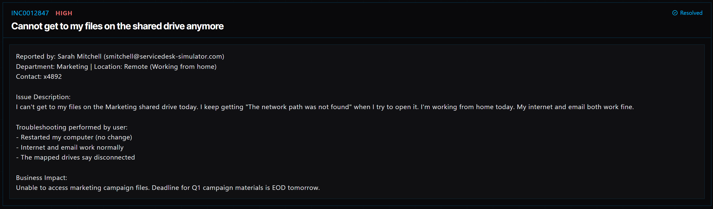

# Ticket 011: Unable to Access Marketing Shared Drive While Working Remotely

## Ticket Information
- **Platform:** ServiceDesk Simulator
- **Incident ID:** INC0012847
- **Status:** Resolved
- **Priority:** High
- **Ticket Type:** Network Access / VPN and Shared Drive
- **Environment:** Simulated IT support environment
- **Reported By:** Sarah Mitchell
- **Email:** smitchell@servicedesk-simulator.com
- **Department:** Marketing
- **Location:** Remote (Working from Home)
- **Contact:** Extension 4892

## 1. Issue Summary

Sarah Mitchell reported that she couldn't access the Marketing shared drive while working from home.

Whenever she tried opening the drive, she received an error saying, "The network path was not found."

Her internet connection and email were working normally, but the mapped network drives were showing as disconnected.

Sarah had already restarted her computer, but that didn't fix the problem.

Since she was working remotely, I needed to check whether her computer was connected to the company's VPN.

## 2. Business Impact

This ticket was marked High priority because Sarah needed access to the Marketing shared drive to continue working on campaign materials.

The team had a deadline for Q1 campaign materials by the end of the following day.

Without access to the shared files, Sarah couldn't complete her work, which could delay the team's progress toward the deadline.

## 3. Troubleshooting Performed

1. **Connected to the user's computer:** Opened Tools → Remote Desktop and selected Connect next to Sarah's PC.

2. **Checked the mapped network drive:** Opened This PC and found that the Marketing drive was still mapped but showing as disconnected.

3. **Checked the VPN connection:** Opened the VPN Client app on Sarah's computer.

4. **Identified the problem:** The VPN Client showed a status of DISCONNECTED. This explained why Sarah could access the internet and email but couldn't reach the company's shared drive.

5. **Connected to the VPN:** Clicked the green Connect button in the VPN Client.

6. **Checked the shared drive again:** Once the VPN connection was established, the Marketing drive reconnected automatically.

7. **Verified access:** Confirmed that the Marketing shared drive could be opened again.

## 4. Resolution

The issue was caused by Sarah's VPN being disconnected.

I connected to her computer through Remote Desktop and checked the Marketing shared drive in This PC.

The drive was still mapped, but it couldn't connect to the file server.

I opened the VPN Client and noticed that it was disconnected. After clicking Connect, the VPN connection was restored.

Once the VPN was connected, the Marketing shared drive became available again without needing to recreate the drive mapping.

The issue was resolved, and the ticket was marked Resolved in the ServiceDesk Simulator.

## 5. Verification

**Remote connection:** Connected to Sarah's computer using the Remote Desktop tool.

**Mapped drive:** Confirmed that the Marketing drive was still mapped but initially disconnected.

**VPN status:** Found that the VPN Client was showing DISCONNECTED.

**VPN connection:** Connected the VPN using the Connect button.

**Shared drive:** Confirmed that the Marketing drive reconnected after the VPN connection was restored.

**File access:** Verified that the shared drive could be opened again.

**Ticket status:** The ServiceDesk Simulator displayed the incident as Resolved.

## 6. Technical Skills Demonstrated

- Remote desktop troubleshooting
- VPN connectivity troubleshooting
- Network drive access troubleshooting
- Understanding mapped network drives
- Basic file server connectivity
- Windows File Explorer navigation
- Identifying network connectivity issues
- Understanding remote access to company resources
- Restoring access to shared folders
- Incident documentation and resolution

## 7. Lessons Learned

This ticket helped me understand the difference between having an internet connection and being connected to a company's internal network.

Sarah could still use the internet and email, but she couldn't access the Marketing shared drive because her VPN was disconnected.

I also learned that a disconnected mapped drive doesn't always mean the drive mapping has been removed or that something is wrong with the file server.

Once I connected the VPN, the drive became available again without having to set it up from scratch.

This showed me why checking the VPN connection is an important troubleshooting step when helping remote employees access company resources.

## 8. Evidence

- Screenshot: 

## 9. Reflection

**What would I do differently or investigate further in a real-world IT environment?**

In a real IT environment, I would first check whether the employee was connected to the company's VPN before making any changes to the shared drive.

I would also check whether the VPN Client was displaying any connection errors or authentication issues.

If the VPN was connected but the drive still wasn't available, I would investigate whether the computer could reach the file server.

I could also check the mapped drive configuration in File Explorer and compare it with the approved network path listed in the company's documentation.

If the drive mapping needed to be recreated, I would use File Explorer → This PC → See more → Map network drive and enter the correct Marketing shared drive path.

After restoring access, I would ask Sarah to open the files she needed and confirm that she could continue working on her campaign materials.
