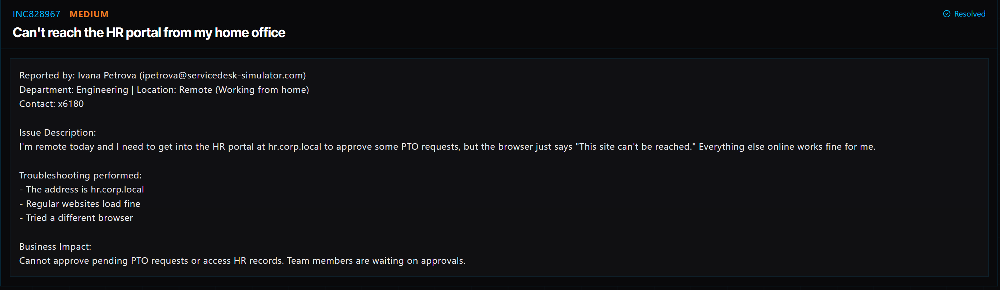

# Ticket 017: Unable to Access Internal HR Portal While Working Remotely

## Ticket Information
- **Platform:** ServiceDesk Simulator
- **Incident ID:** INC828967
- **Status:** Resolved
- **Priority:** Medium
- **Ticket Type:** Network Access / VPN Connectivity
- **Environment:** Simulated IT support environment
- **Reported By:** Ivana Petrova
- **Email:** ipetrova@servicedesk-simulator.com
- **Department:** Engineering
- **Location:** Remote (Working from Home)
- **Contact:** Extension 6180
- **Affected System:** Internal HR Portal (hr.corp.local)

## 1. Issue Summary

Ivana Petrova contacted IT because she couldn't access the company's internal HR portal while working from home.

She needed to log in to hr.corp.local to approve employee PTO requests, but every time she tried opening the website, her browser displayed the message "This site can't be reached."

Ivana mentioned that her internet connection was working normally and that she could access other websites without any problems.

She had also tried using a different browser, but the HR portal still wouldn't load.

Since the website was an internal company resource, I needed to check whether her computer was connected to the corporate network through the VPN.

## 2. Business Impact

This ticket was marked Medium priority because Ivana couldn't access the HR portal to approve pending PTO requests or review HR records.

Employees were waiting for their time-off requests to be approved, and the access issue was preventing Ivana from completing those tasks.

Restoring access was important so she could continue handling employee requests without causing further delays.

## 3. Troubleshooting Performed

1. **Reviewed the website address:** Noticed that Ivana was trying to access hr.corp.local, which is an internal company website that requires access to the corporate network.

2. **Connected to the user's computer:** Opened Tools → Remote Desktop and selected Connect next to Ivana's PC.

3. **Tested the HR portal:** Opened the Web Browser and entered hr.corp.local to see whether the website would load.

4. **Confirmed the error:** The browser displayed "This site can't be reached," matching the issue Ivana reported.

5. **Checked the VPN connection:** Opened the VPN Client application on Ivana's computer.

6. **Connected to the corporate network:** Clicked Connect in the VPN Client to establish the VPN connection.

7. **Tested the HR portal again:** Returned to the Web Browser and reloaded hr.corp.local.

8. **Verified access:** Confirmed that the HR portal loaded successfully after connecting to the VPN.

## 4. Resolution

The issue was caused by Ivana not being connected to the corporate VPN while working remotely.

Although her regular internet connection was working, the HR portal was an internal company website that required access to the corporate network.

I connected to her computer through Remote Desktop and confirmed that the HR portal wouldn't load.

I then opened the VPN Client and connected her computer to the corporate network.

After the VPN connection was established, I returned to the browser and refreshed hr.corp.local.

The HR portal loaded successfully, and the ServiceDesk Simulator marked the ticket as Resolved.

## 5. Verification

**Remote connection:** Connected to Ivana's computer using Remote Desktop.

**Initial website test:** Confirmed that hr.corp.local displayed "This site can't be reached."

**Internal website:** Identified the HR portal as a resource requiring corporate network access.

**VPN connection:** Connected to the corporate VPN using the VPN Client.

**Website retest:** Reloaded hr.corp.local after establishing the VPN connection.

**Access confirmation:** Verified that the HR portal loaded successfully.

**Ticket status:** The ServiceDesk Simulator displayed the incident as Resolved.

**Application functionality:** A separate test of submitting or approving PTO requests was not documented.

## 6. Technical Skills Demonstrated

- Remote desktop troubleshooting
- VPN connectivity troubleshooting
- Internal network access troubleshooting
- Understanding corporate intranet resources
- Basic DNS and internal domain concepts
- Troubleshooting website connectivity
- Differentiating internet access from corporate network access
- Testing network connectivity after configuration changes
- Supporting remote employees
- Incident documentation and resolution

## 7. Lessons Learned

This ticket helped me understand that having a working internet connection doesn't always mean an employee can access every company resource.

Ivana could browse regular websites without any issues, but she couldn't open the HR portal because it was only available through the corporate network.

At first, the error looked like a website problem. However, noticing that the address ended in corp.local helped me understand that it was an internal resource.

Once I connected the VPN, the website loaded normally.

I learned that checking whether a remote employee is connected to the company's VPN should be one of the first troubleshooting steps when they can't access an internal website.

This ticket also helped me better understand how VPN connections allow remote employees to securely access company resources.

## 8. Evidence

- Screenshot: 

## 9. Reflection

**What would I do differently or investigate further in a real-world IT environment?**

In a real IT environment, I would first confirm whether the employee was connected to the company's VPN before troubleshooting the website itself.

I would also check whether the VPN Client was displaying any connection errors or authentication problems.

If the VPN was connected but the HR portal still wouldn't load, I would investigate whether the computer could resolve the internal website address.

For example, I could use commands such as:

- `nslookup hr.corp.local` to check whether the internal domain resolves to an IP address.
- `ipconfig /all` to review the computer's network configuration and DNS settings.
- `Test-NetConnection hr.corp.local -Port 443` in PowerShell to test connectivity to the website's HTTPS port.

I would also check whether the VPN was configured to provide access to the correct internal network resources.

After restoring access, I would ask Ivana to confirm that she could sign in to the HR portal and complete her pending PTO approvals.

Finally, I would document the troubleshooting steps and remind her that she needs to connect to the corporate VPN before accessing internal company websites while working remotely.
