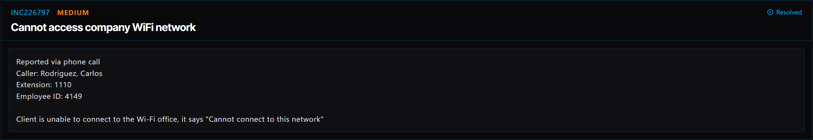

# Ticket 018: Unable to Connect to Company Wi-Fi Network

## Ticket Information
- **Platform:** ServiceDesk Simulator
- **Incident ID:** INC226797
- **Status:** Resolved
- **Priority:** Medium
- **Ticket Type:** Network Access / Wi-Fi Connectivity
- **Environment:** Simulated IT support environment
- **Reported By:** Carlos Rodriguez
- **Reported Via:** Phone Call
- **Employee ID:** 4149
- **Contact:** Extension 1110
- **Affected Network:** SDSim-Secure

## 1. Issue Summary

Carlos Rodriguez contacted IT because his laptop wouldn't connect to the company's Wi-Fi network.

Whenever he tried connecting, Windows displayed the message "Cannot connect to this network."

Since Carlos couldn't establish a wireless connection, I needed to check his network settings and find out what was preventing the laptop from connecting.

The troubleshooting process involved using a temporary wired connection so I could access his computer remotely and fix the wireless connection.

## 2. Business Impact

This ticket was marked Medium priority because Carlos couldn't connect his laptop to the company's wireless network.

Without a working network connection, he could have trouble accessing company resources, applications, and other services needed for his work.

Restoring Wi-Fi connectivity was important so he could continue working without relying on a wired connection.

## 3. Troubleshooting Performed

1. **Contacted the user:** Opened Company Chat and asked Carlos to connect his laptop to the network using an Ethernet cable.

2. **Established a remote connection:** Once the laptop had a wired connection, opened Tools → Remote Desktop and selected Connect next to Carlos's PC.

3. **Opened network settings:** Navigated to Network & Internet settings on his computer.

4. **Removed the saved Wi-Fi profile:** Selected Forget to remove the existing wireless network profile that was causing the connection problem.

5. **Checked company documentation:** Opened Tools → Documentation → WiFi Networks to find the correct network information.

6. **Located the wireless network:** Found the company's secure wireless network, SDSim-Secure, along with its connection key.

7. **Reconnected to Wi-Fi:** Selected SDSim-Secure from the available wireless networks and entered the key provided in the company's documentation.

8. **Verified the connection:** Confirmed that Carlos's laptop successfully connected to the company Wi-Fi network.

## 4. Resolution

The issue was caused by a corrupted saved Wi-Fi profile on Carlos's laptop.

I first asked Carlos to connect his laptop using an Ethernet cable so I could access the computer remotely.

After connecting through Remote Desktop, I opened Network & Internet settings and removed the existing Wi-Fi profile using the Forget option.

I then checked the company's WiFi Networks documentation to find the correct connection information for SDSim-Secure.

After selecting the network and entering the correct key, the laptop connected successfully.

The ServiceDesk Simulator displayed the ticket as Resolved.

## 5. Verification

**Temporary network connection:** Asked Carlos to connect his laptop using an Ethernet cable.

**Remote access:** Connected to his computer through Remote Desktop.

**Network settings:** Opened Network & Internet settings to troubleshoot the wireless connection.

**Wi-Fi profile:** Removed the existing saved wireless network profile.

**Network documentation:** Located the correct SDSim-Secure connection information.

**Wi-Fi connection:** Reconnected the laptop using the documented network key.

**Connection test:** Confirmed that the laptop successfully connected to SDSim-Secure.

**Ticket status:** The ServiceDesk Simulator displayed the incident as Resolved.

**Application access:** A separate test of internal company applications was not documented.

## 6. Technical Skills Demonstrated

- Wireless network troubleshooting
- Windows Network & Internet settings
- Troubleshooting saved Wi-Fi profiles
- Removing and recreating wireless connections
- Ethernet connectivity
- Remote desktop troubleshooting
- Understanding Wi-Fi network authentication
- Following internal IT documentation
- Restoring network connectivity
- Verifying network connections
- Incident documentation and resolution

## 7. Lessons Learned

This ticket helped me understand how a saved Wi-Fi profile can sometimes prevent a computer from connecting to a network.

Carlos was receiving a connection error, but that didn't necessarily mean the entire company Wi-Fi network was down.

By removing the saved profile and reconnecting with the correct network information, I was able to restore his wireless connection.

I also learned why having a backup way to connect to a computer is helpful during troubleshooting.

Since Carlos couldn't use Wi-Fi, connecting through Ethernet allowed me to access his computer remotely and work on the problem.

Another thing I learned was the importance of using company documentation instead of guessing network settings or passwords.

## 8. Evidence

- Screenshot: 

## 9. Reflection

**What would I do differently or investigate further in a real-world IT environment?**

In a real IT environment, I would first ask Carlos whether other employees were experiencing the same Wi-Fi issue.

This would help me determine whether the problem was affecting only his laptop or multiple devices.

I would also check whether his wireless adapter was enabled and whether the correct company network was available.

If removing and reconnecting the Wi-Fi profile didn't fix the issue, I would investigate the wireless adapter driver, authentication settings, and any available connection error logs.

I could also use Windows commands such as:

- `ipconfig /all` to review the computer's network configuration.
- `netsh wlan show interfaces` to check the wireless adapter's connection status.
- `netsh wlan show profiles` to review saved wireless network profiles.
- `ipconfig /renew` to request a new IP address when appropriate.

After reconnecting the laptop, I would test whether Carlos could access the internet and any internal company resources he needed.

I would also have him disconnect the Ethernet cable and confirm that the Wi-Fi connection continued working on its own.

Finally, I would document the troubleshooting steps and make sure no company Wi-Fi passwords were included in the ticket notes or screenshots.
