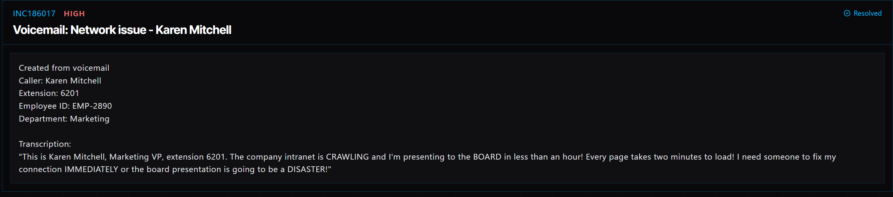

# Ticket 020: Slow Company Intranet Connection

## Ticket Information
- **Platform:** ServiceDesk Simulator
- **Incident ID:** INC186017
- **Status:** Resolved
- **Priority:** High
- **Ticket Type:** Network Access / Wi-Fi Performance Issue
- **Environment:** Simulated IT support environment
- **Reported By:** Karen Mitchell
- **Reported Via:** Voicemail
- **Employee ID:** EMP-2890
- **Department:** Marketing
- **Position:** Vice President
- **Contact:** Extension 6201
- **Computer:** SD1065
- **Affected Network:** SDSim-Secure

## 1. Issue Summary

Karen Mitchell, the Vice President of Marketing, contacted IT because the company's intranet was running extremely slowly on her computer.

She mentioned that pages were taking almost two minutes to load, making it difficult for her to prepare for an upcoming board presentation.

Karen was frustrated because she had less than an hour before the presentation and needed her connection working as soon as possible.

Since the issue involved slow network performance, I needed to check her computer's network settings and see whether reconnecting to the company's Wi-Fi would improve the connection.

## 2. Business Impact

This ticket was marked High priority because Karen was preparing for an important board presentation that was scheduled to begin in less than an hour.

The slow intranet connection was preventing her from accessing company resources efficiently.

If the issue continued, it could delay her preparation and affect her ability to deliver the presentation.

Restoring normal network performance was important so Karen could access the information she needed before the meeting.

## 3. Troubleshooting Performed

1. **Opened Remote Desktop:** Navigated to Remote Desktop from the ServiceDesk Simulator dashboard.

2. **Located the user's computer:** Found Karen's workstation, SD1065, and connected to it remotely.

3. **Opened network settings:** Navigated to Network & Internet settings to review the computer's wireless connection.

4. **Disconnected from Wi-Fi:** Disconnected the computer from its current wireless network.

5. **Removed the saved network profile:** Selected Forget for the SDSim-Secure network to clear the existing Wi-Fi configuration.

6. **Checked company documentation:** Opened Documentation and located the WiFi Networks article under Network & Connectivity.

7. **Located the correct network information:** Reviewed the documentation to find the security key for SDSim-Secure.

8. **Reconnected to the company network:** Selected SDSim-Secure from the available wireless networks and entered the security key provided in the documentation.

9. **Tested the intranet connection:** Opened internal company websites to check whether they were loading normally.

10. **Verified network performance:** Confirmed that the internal websites were loading at normal speed after reconnecting to Wi-Fi.

## 4. Resolution

The issue was resolved by removing and reconnecting Karen's saved Wi-Fi network profile.

I connected to her computer through Remote Desktop and opened Network & Internet settings.

After disconnecting from the current wireless connection, I removed the saved SDSim-Secure profile using the Forget option.

I then checked the company's WiFi Networks documentation to find the correct security key.

Once I reconnected the computer to SDSim-Secure, I tested the company's internal websites again.

The pages loaded at normal speed, and the ServiceDesk Simulator marked the ticket as Resolved.

Although resetting the wireless profile restored normal performance, the exact underlying cause of the slowdown was not independently confirmed.

## 5. Verification

**Remote connection:** Connected to Karen's workstation, SD1065, using Remote Desktop.

**Network settings:** Opened Network & Internet settings to review the wireless connection.

**Wi-Fi profile:** Disconnected from the current network and removed the saved SDSim-Secure profile.

**Network documentation:** Located the correct SDSim-Secure security key in the company's WiFi Networks documentation.

**Wireless connection:** Successfully reconnected to SDSim-Secure.

**Intranet performance:** Confirmed that internal company websites loaded at normal speed.

**Ticket status:** The ServiceDesk Simulator displayed the incident as Resolved.

**Performance measurements:** Exact network speed and latency measurements were not documented.

## 6. Technical Skills Demonstrated

- Remote desktop troubleshooting
- Wireless network troubleshooting
- Network performance troubleshooting
- Windows Network & Internet settings
- Managing saved Wi-Fi profiles
- Reconfiguring wireless network connections
- Wi-Fi authentication and connectivity
- Using internal IT documentation
- Troubleshooting slow intranet connections
- Verifying network performance after troubleshooting
- Supporting executive users
- Prioritizing incidents based on business impact
- Incident documentation and resolution

## 7. Lessons Learned

This ticket helped me understand that network problems don't always mean someone has completely lost their connection.

Karen was still able to access the intranet, but the pages were loading so slowly that it was affecting her work.

I learned that removing a saved Wi-Fi profile and reconnecting can sometimes resolve connection problems without having to make changes to the network equipment.

I also learned how important it is to stay focused when someone is frustrated and needs help quickly.

Karen had an important presentation coming up, so I needed to work through the troubleshooting steps without getting distracted by the urgency of the situation.

Another thing I learned was the importance of checking company documentation before reconnecting a device to a secure network.

Instead of guessing the Wi-Fi password or changing unnecessary settings, I used the documented network information to restore the connection.

## 8. Evidence

- Screenshot: 

## 9. Reflection

**What would I do differently or investigate further in a real-world IT environment?**

In a real IT environment, I would first ask Karen whether the slow connection was affecting all websites or only the company's internal intranet.

I would also check whether other employees were experiencing similar performance issues.

This would help me determine whether the problem was limited to Karen's computer or affecting a larger part of the network.

Before resetting the Wi-Fi profile, I would review the wireless signal strength, connection status, and network adapter information.

I could also use Windows commands such as:

- `ipconfig /all` to review the computer's network configuration.
- `netsh wlan show interfaces` to check wireless connection details and signal strength.
- `ping` to test connectivity and response times to an approved internal network destination.
- `tracert` to investigate the network path if the performance issue continued.

Since Karen had an important presentation approaching, I would also consider whether a temporary Ethernet connection was available to help her continue working while troubleshooting.

After restoring the connection, I would test the internal websites again and ask Karen to confirm that she could access the information needed for her presentation.

Finally, I would document the troubleshooting steps and monitor for recurring performance problems.
