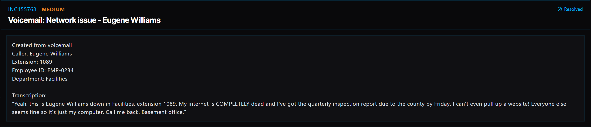

# Ticket 027: Internet Connection Not Working – Eugene Williams

## Ticket Information
- **Ticket ID:** INC155768
- **Platform:** ServiceDesk Simulator
- **Status:** Resolved
- **Priority:** Medium
- **Ticket Type:** Network Connectivity / Wi-Fi Troubleshooting
- **Environment:** Simulated IT support environment
- **Reported By:** Eugene Williams (Facilities)
- **Location:** Basement office
- **Extension:** 1089
- **Employee ID:** EMP-0234
- **Workstation:** SD1031

## 1. Issue Summary
Eugene Williams from Facilities left a voicemail because his computer could not connect to the internet. He couldn't open any websites, but other employees appeared to have working connections. That suggested the problem might be limited to his workstation rather than the entire office network.

## 2. Business Impact
Eugene needed internet access to finish a quarterly inspection report due to the county by Friday. Without a working connection, he could fall behind on the report and risk missing the deadline.

## 3. Troubleshooting Performed
1. I opened **Remote Desktop** from the ServiceDesk Simulator dashboard and connected to Eugene's workstation, **SD1031**.
2. I opened **Network & Internet** settings to check his wireless connection.
3. I disconnected the computer from its current Wi-Fi connection.
4. I selected **Forget** for the **SDSim-Secure** network to clear the saved connection profile.
5. I opened **Documentation → Network & Connectivity → WiFi Networks** to find the correct security key for SDSim-Secure.
6. I selected **SDSim-Secure** again and entered the security key from the documentation to reconnect.
7. I checked that the computer could access the internet after reconnecting.

## 4. Resolution
I reconnected Eugene's workstation to the company Wi-Fi after removing the old saved network profile and using the documented network key. Internet connectivity was restored, and the simulator showed the ticket as **Resolved**.

## 5. Verification
- **Wi-Fi connection:** Reconnected to SDSim-Secure using the documented security key.
- **Internet access:** Verified that connectivity was working again.
- **Ticket status:** ServiceDesk Simulator displayed **Resolved**.

## 6. Technical Skills Demonstrated
- Remote Desktop support and workstation troubleshooting
- Windows network and internet settings
- Troubleshooting saved Wi-Fi connection profiles
- Reconnecting to a secured wireless network
- Using internal IT documentation for configuration details
- Checking connectivity after making a change
- Prioritizing support based on the user's work and deadlines

## 7. Lessons Learned
A computer can lose internet access even when the rest of the office network is working. In this case, checking the individual workstation made more sense than assuming there was a building-wide outage. I also learned how forgetting and reconnecting to a Wi-Fi network can help when a saved connection profile is causing problems.

I would always use the company's approved documentation to get the network key instead of guessing or using a password from an unverified source.

## 8. Evidence
- Screenshot: 

## 9. Reflection
In a real IT environment, I would first confirm whether the issue affected just one device or multiple users. If reconnecting to Wi-Fi didn't help, I would check the workstation's IP address, default gateway, DNS settings, and whether it could reach internal and external resources. I would also ask Eugene to confirm that the websites he needs for his report are loading normally before closing the ticket.
