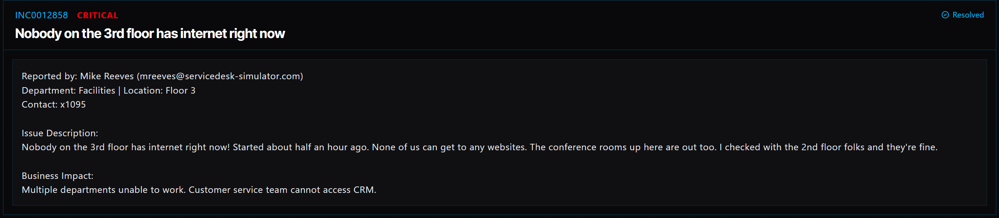

# Ticket 006: Third Floor Internet Outage

## Ticket Information
- **Platform:** ServiceDesk Simulator
- **Incident ID:** INC0012858
- **Status:** Resolved
- **Priority:** Critical
- **Ticket Type:** Network / Internet Connectivity
- **Environment:** Simulated IT support environment
- **Reported By:** Mike Reeves
- **Email:** mreeves@servicedesk-simulator.com
- **Department:** Facilities
- **Location:** Floor 3
- **Contact:** Extension 1095

## 1. Issue Summary

Mike Reeves reported that nobody on the third floor could access the internet. The issue had started about 30 minutes before he submitted the ticket.

Employees were unable to open websites, and the conference rooms on the third floor were also affected.

Mike checked with employees on the second floor and confirmed that their internet was working.

Since the problem was only affecting the third floor, I needed to check the network equipment supporting that area.

## 2. Business Impact

This ticket was marked Critical because the internet outage affected multiple departments on the third floor.

Employees were unable to complete their normal work, and the Customer Service team could not access the CRM system.

Since the outage affected an entire floor, restoring connectivity was important to getting employees back to work and preventing further delays.

## 3. Troubleshooting Performed

1. **Opened the Server Room:** Navigated to Tools → Server Room in the ServiceDesk Simulator.

2. **Checked network devices:** Opened the Devices tab to locate the network equipment.

3. **Located the affected switch:** Found the device labeled "Floor 3 Switch."

4. **Restarted the switch:** Clicked the Power button to reboot the Floor 3 Switch.

5. **Waited for the device to restart:** Allowed approximately 30–60 seconds for the switch to come back online.

6. **Checked with the user:** Contacted Mike through Company Chat and asked whether the internet connection was working again.

7. **Confirmed the fix:** Mike confirmed that internet connectivity had been restored.

## 4. Resolution

The issue was resolved by rebooting the Floor 3 Switch.

I opened the Server Room, went to the Devices tab, and located the switch responsible for the third floor.

I restarted the switch using the Power button and waited for it to come back online.

After the restart, I contacted Mike through Company Chat to see whether employees could access the internet again.

Mike confirmed that connectivity was restored, and the ticket was marked Resolved.

The exact reason the switch needed to be restarted was not determined during this ticket.

## 5. Verification

**Affected area:** The outage was reported on the third floor, while the second floor still had internet access.

**Network device:** Located the Floor 3 Switch in the Server Room.

**Switch restart:** Rebooted the switch and waited approximately 30–60 seconds.

**Connectivity check:** Contacted Mike through Company Chat after restarting the switch.

**User confirmation:** Mike confirmed that internet access was working again.

**Ticket status:** The ServiceDesk Simulator displayed the incident as Resolved.

## 6. Technical Skills Demonstrated

- Basic network troubleshooting
- Identifying network connectivity issues
- Understanding network switches
- Network device management
- Troubleshooting floor-specific network outages
- Restarting network equipment
- Identifying the scope of an outage
- Communicating with users through Company Chat
- Verifying network connectivity after troubleshooting
- Incident documentation and resolution

## 7. Lessons Learned

This ticket helped me understand how a problem with one network device can affect an entire section of a building.

Since employees on the second floor still had internet access, that helped narrow down the issue to the third floor instead of assuming the entire building had lost connectivity.

Restarting the Floor 3 Switch restored the connection.

I also learned how important it is to confirm with the user that the issue is fixed instead of assuming everything is working just because the device comes back online.

## 8. Evidence

- Screenshot: 

## 9. Reflection

**What would I do differently or investigate further in a real-world IT environment?**

In a real IT environment, I would want to understand why the switch stopped providing connectivity.

Before restarting the switch, I would check its status, network connections, and any available alerts or logs to see whether there were signs of a hardware or configuration issue.

I would also check whether the switch was experiencing power problems, port failures, or other network errors.

Since rebooting a switch can temporarily disconnect users, I would follow the company's procedures before restarting equipment.

After restoring connectivity, I would monitor the switch to make sure the issue does not happen again.

I would also confirm that employees could access important systems, including the CRM application used by Customer Service.
