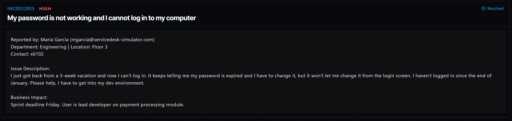

# Ticket 001: Expired Password Preventing Computer Login

## Ticket Information
- **Platform:** ServiceDesk Simulator
- **Incident ID:** INC0012855
- **Status:** Resolved
- **Priority:** High
- **Ticket Type:** Account Access / Password Expiration
- **Environment:** Simulated IT support environment
- **Reported By:** Maria Garcia
- **Email:** mgarcia@servicedesk-simulator.com
- **Department:** Engineering
- **Location:** Floor 3
- **Contact:** Extension 6102

## 1. Issue Summary

Maria Garcia reported that she couldn't log in to her computer after returning from a three-week vacation.

When she tried signing in, she received a message saying her password had expired and needed to be changed. However, the login screen wouldn't allow her to complete the password change.

Maria needed access to her development environment so she could get back to work.

## 2. Business Impact

This ticket was marked High priority because Maria is the lead developer working on a payment-processing module.

Her team had a sprint deadline coming up on Friday, and without access to her computer, she couldn't continue her development work.

Getting her account working again was important so she could return to her tasks without causing delays for the team.

## 3. Troubleshooting Performed

1. **Located the user's account:** Opened Tools → Directory in the ServiceDesk Simulator.

2. **Searched for the user:** Entered "mgarcia" in the directory search and selected Maria Garcia's account.

3. **Opened authentication settings:** Navigated to the Authentication tab.

4. **Started identity verification:** Clicked Send Verification Code to begin verifying Maria's identity.

5. **Verified the user:** Contacted Maria through Company Chat and asked her to provide the verification code. Entered the code into the simulator to complete the verification process.

6. **Reset the password:** After her identity was verified, selected Reset Password to generate a temporary password.

7. **Sent the temporary password:** Used Company Chat to provide Maria with the temporary password instead of sending it through email, following the simulator's instructions.

8. **Explained the next step:** Let Maria know that she needed to change the temporary password when she logged in.

## 4. Resolution

The issue was caused by Maria's password expiring while she was away from work.

I located her account in the Directory and completed the identity verification process before resetting her password.

Once her identity was confirmed, I generated a temporary password and sent it to her through Company Chat.

I also reminded her to change the temporary password when she signed in.

The ticket was marked Resolved in the ServiceDesk Simulator.

## 5. Verification

**Account lookup:** Located Maria's account using her username, mgarcia.

**Identity verification:** Completed the verification process using the code provided through Company Chat.

**Password reset:** Generated a temporary password after verifying her identity.

**Password delivery:** Sent the temporary password through Company Chat rather than email.

**User instructions:** Informed Maria that she needed to change her password at her next login.

**Ticket status:** The ServiceDesk Simulator displayed the incident as Resolved.

**Login confirmation:** A successful login after the password reset was not independently documented.

## 6. Technical Skills Demonstrated

- User account management
- Directory navigation and account lookup
- Password expiration troubleshooting
- Identity verification
- Password reset procedures
- Authentication and account recovery
- Secure handling of temporary credentials
- Communicating with users through Company Chat
- Incident prioritization and documentation
- Following IT support security procedures

## 7. Lessons Learned

This ticket helped me understand why verifying someone's identity is an important part of resetting passwords.

Even though Maria couldn't access her computer and needed to get back to work quickly, I still had to follow the proper verification steps before making changes to her account.

I also learned that resetting a password involves more than just generating a new one. It's important to use the approved communication method and explain what the user needs to do next.

Following these steps helps protect user accounts while getting employees back into their systems.

## 8. Evidence

- Screenshot: 

## 9. Reflection

**What would I do differently or investigate further in a real-world IT environment?**

In a real IT environment, I would first check whether the account was locked, disabled, or simply affected by an expired password.

I would also review the organization's password reset policy and make sure I was following the approved identity verification process.

After resetting the password, I would ask Maria to confirm that she could log in successfully and access her development environment.

Since she works on a payment-processing module, I would also want to make sure her account permissions were still correct and that she could access the tools needed for her work.

Finally, I would document the password reset in the ticket without recording the temporary password or any verification codes.
