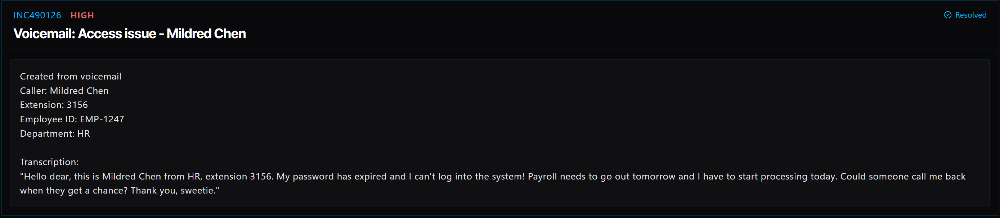

# Ticket 021: Expired Password Preventing HR Employee Login

## Ticket Information
- **Platform:** ServiceDesk Simulator
- **Incident ID:** INC490126
- **Status:** Resolved
- **Priority:** High
- **Ticket Type:** Account Access / Password Expiration
- **Environment:** Simulated IT support environment
- **Reported By:** Mildred Chen
- **Reported Via:** Voicemail
- **Employee ID:** EMP-1247
- **Username:** mchen
- **Department:** Human Resources (HR)
- **Contact:** Extension 3156

## 1. Issue Summary

Mildred Chen from HR contacted IT through voicemail because her password had expired and she couldn't log in to her computer.

She explained that payroll needed to go out the following day and she had to begin processing it that day.

Since she couldn't access her account, she wasn't able to get started on her work.

I needed to locate her account in the Directory, verify her identity, and reset her expired password so she could regain access.

## 2. Business Impact

This ticket was marked High priority because Mildred needed access to her account to begin processing payroll.

Payroll was scheduled for the following day, so any delay in restoring her access could affect the payroll preparation process.

Resolving the issue quickly was important, but I still needed to follow the proper security procedures before resetting her password.

## 3. Troubleshooting Performed

1. **Opened the Directory:** Navigated to the Directory from the ServiceDesk Simulator dashboard.
2. **Located the user's account:** Searched for the username `mchen` and selected Mildred Chen's account.
3. **Started identity verification:** Sent Mildred a verification code using the Directory's verification process.
4. **Verified her identity:** Completed the verification process before making any changes to her account.
5. **Reset the expired password:** Once her identity was verified, selected Reset Password to generate a temporary password.
6. **Confirmed the reset:** Verified that the password reset was completed successfully in the simulator.

## 4. Resolution

The issue was caused by Mildred's expired password, which prevented her from logging in.

I located her account in the Directory and completed the required identity verification process.

After confirming her identity, I reset the expired password and verified that the reset was successful.

The ServiceDesk Simulator displayed the ticket as Resolved.

## 5. Verification

**Account lookup:** Located Mildred's account using the username `mchen`.

**Identity verification:** Completed the verification process before resetting the password.

**Password reset:** Generated a temporary password using the Directory's Reset Password option.

**Reset confirmation:** Confirmed that the password reset was successful.

**Ticket status:** The ServiceDesk Simulator displayed the incident as Resolved.

**Login confirmation:** A successful login after the reset was not independently documented.

## 6. Technical Skills Demonstrated

- User account management
- Directory navigation and account lookup
- Password expiration troubleshooting
- Identity verification and authentication
- Password reset procedures
- Temporary password management
- Following account security procedures
- Incident prioritization based on business impact
- Supporting HR employees
- Incident documentation and resolution

## 7. Lessons Learned

This ticket helped me understand how something as simple as an expired password can affect an important business process.

Mildred needed to begin processing payroll, but she couldn't access her account.

Even though she was polite and understanding about the situation, I still needed to verify her identity before resetting her password.

I learned that the urgency of a request shouldn't change the security steps required to protect an employee's account.

This ticket also reminded me that IT support isn't just about fixing technical problems. It's also about helping employees get back to the work they need to complete.

## 8. Evidence

- Screenshot: 

## 9. Reflection

**What would I do differently or investigate further in a real-world IT environment?**

In a real IT environment, I would first verify Mildred's identity using the company's approved verification process.

I would also check her account status to confirm that the password was expired and that there weren't any additional issues, such as an account lockout.

If the account was managed through Active Directory or Microsoft Entra ID, I would follow the organization's password reset procedures.

After resetting the password, I would provide the temporary credentials through an approved secure method and have Mildred change the password when she signs in, if required by company policy.

I would then ask her to confirm that she could log in successfully and access the payroll system.

Since payroll processing was time-sensitive, I would make sure the issue was fully resolved before closing the ticket.

Finally, I would document the steps taken without including passwords or verification codes in the ticket notes.
  
