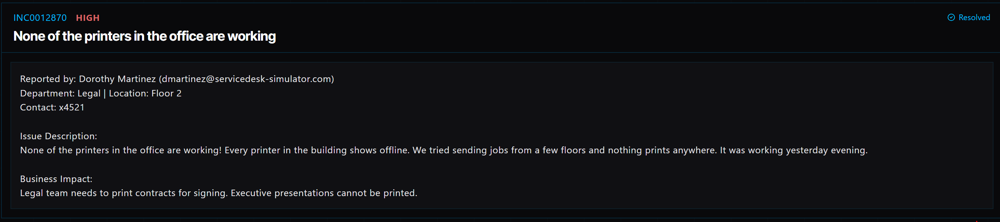

# Ticket 002: None of the Printers in the Office Are Working

## Ticket Information
- **Platform:** ServiceDesk Simulator
- **Incident ID:** INC0012870
- **Status:** Resolved
- **Priority:** High
- **Ticket Type:** Printer / Printing Services
- **Environment:** Simulated IT support environment
- **Reported By:** Dorothy Martinez
- **Email:** dmartinez@servicedesk-simulator.com
- **Department:** Legal
- **Location:** Floor 2
- **Contact:** Extension 4521

## 1. Issue Summary

Dorothy Martinez reported that none of the printers in the office were working. Printers throughout the building were showing as offline, and employees on multiple floors were unable to print anything.

The printers had been working the previous evening, so I needed to find out what could have caused the sudden outage.

## 2. Business Impact

This issue was marked High priority because the Legal team needed to print contracts for signing. Executive presentations also needed to be printed.

Since the problem affected the entire building, it was not just one employee having trouble with a printer. Multiple employees were affected, which could delay important work.

## 3. Troubleshooting Performed

1. **Opened the Server Room:** Went to Tools → Server Room in the ServiceDesk Simulator.
2. **Located the print server:** Selected the Servers tab and looked for PRINT01.
3. **Checked the server status:** Found that PRINT01 was showing as Down.
4. **Identified the problem:** Since multiple printers were offline, finding the print server down helped explain why employees across the building could not print.
5. **Restarted the server:** Selected PRINT01 and clicked Reboot.
6. **Waited for the server to come back online:** Gave the server time to restart before checking with the user.
7. **Tested printing:** Contacted Dorothy through Company Chat and asked her to try printing again.
8. **Confirmed the fix:** Dorothy confirmed that printing was working again.

## 4. Resolution

The issue was caused by the PRINT01 server being down.

I opened the Server Room, located PRINT01, and confirmed that the server was offline. I restarted it using the Reboot option and waited for it to come back online.

After the restart, I reached out to Dorothy through Company Chat to see if she could print again. She confirmed that everything was working, so the ticket was marked Resolved.

## 5. Verification

**Server status:** PRINT01 was initially showing as Down.

**Server restart:** Rebooted PRINT01 and waited for it to come back online.

**Printing test:** Asked Dorothy to try printing after the server restarted.

**User confirmation:** Dorothy confirmed that printing was working again.

**Ticket status:** The simulator showed the incident as Resolved.

## 6. Technical Skills Demonstrated

- Checking server status and availability
- Troubleshooting shared printing services
- Navigating server management tools
- Identifying server-related issues
- Restarting a server
- Understanding how print servers support multiple users
- Communicating with users through Company Chat
- Testing and confirming a resolution
- Documenting and closing IT incidents

## 7. Lessons Learned

This ticket helped me understand how one server can affect multiple employees and devices across an office.

At first, it might seem like a printer problem, but since every printer in the building was offline, it made more sense to check the shared print server.

Finding PRINT01 down helped narrow down the issue. Restarting the server brought the printing service back, and checking with Dorothy confirmed that the fix worked.

It also reminded me that fixing the immediate problem is only part of troubleshooting. It's important to understand what caused the issue so it can be prevented from happening again.

## 8. Evidence

- Screenshot: 

## 9. Reflection

**What would I do differently or investigate further in a real-world IT environment?**

If this happened at an actual company, I would want to look into why PRINT01 went down in the first place. I would check the server logs and see if there were any errors, unexpected shutdowns, or service failures.

I would also keep an eye on the server after restarting it to make sure it stays online and employees can continue printing without issues.

Getting the printers working again was important, but finding out why the server went down could help prevent the same problem from happening again.
