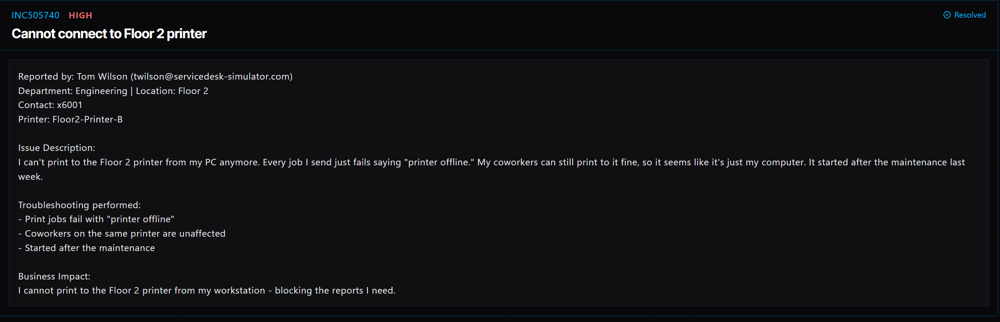

# Ticket 023: Unable to Connect to Floor 2 Printer

## Ticket Information
- **Platform:** ServiceDesk Simulator
- **Incident ID:** INC505740
- **Status:** Resolved
- **Priority:** High
- **Ticket Type:** Printer Troubleshooting / TCP/IP Printer Configuration
- **Environment:** Simulated IT support environment
- **Reported By:** Tom Wilson
- **Department:** Engineering
- **Location:** Floor 2
- **Contact:** Extension 6001
- **Affected Printer:** Floor2-Printer-B

## 1. Issue Summary

Tom Wilson from Engineering contacted IT because he could no longer print to the Floor 2 printer from his computer.

Every time he tried printing, the job failed with a message saying the printer was offline.

Tom mentioned that his coworkers could still use the same printer without any problems. He also noticed that the issue started after maintenance was performed the previous week.

Since other employees could print successfully, I focused on checking the printer configuration on Tom's workstation rather than assuming the printer itself was down.

## 2. Business Impact

This ticket was marked High priority because Tom needed to print reports for his work, but his computer could no longer connect to the printer.

Although the printer was still working for other employees, the issue prevented Tom from completing tasks that required printed documents.

Restoring the printer connection would allow him to continue working without relying on another employee's computer.

## 3. Troubleshooting Performed

1. **Checked company documentation:** Opened Tools → Documentation → Print Server to find the correct IP address for Floor2-Printer-B.

2. **Connected to the user's computer:** Opened Tools → Remote Desktop and selected Connect next to Tom's PC.

3. **Opened printer settings:** Navigated to Settings → Devices to review the printers configured on his workstation.

4. **Located the offline printer:** Found the Floor 2 printer that was showing as offline.

5. **Removed the existing printer:** Selected Remove to delete the printer's current configuration from the computer.

6. **Started adding the printer again:** Selected Add a printer or scanner.

7. **Chose manual printer setup:** Clicked The printer that I want isn't listed and selected Add a printer using a TCP/IP address or hostname.

8. **Entered the correct printer address:** Used the IP address from the company's Print Server documentation to configure the printer connection.

9. **Tested the printer:** Opened the printer's properties, selected the General tab, and clicked Print Test Page.

10. **Confirmed with the user:** Checked with Tom to make sure the test page printed and that he could use the printer again.

## 4. Resolution

The problem was related to the printer configuration on Tom's workstation.

Since his coworkers could still print to Floor2-Printer-B, I knew the issue was likely limited to his computer.

I checked the Print Server documentation to find the correct printer IP address and then connected to Tom's workstation remotely.

After removing the existing offline printer, I added it again using the documented TCP/IP address.

I printed a test page to verify the connection and confirmed with Tom that printing was working again.

The ServiceDesk Simulator displayed the ticket as Resolved.

## 5. Verification

**Printer documentation:** Located the correct IP address in the Print Server documentation.

**Remote access:** Connected to Tom's workstation using Remote Desktop.

**Printer configuration:** Removed the existing offline printer and added it again using TCP/IP.

**Test page:** Used the printer's Print Test Page option to check connectivity.

**User confirmation:** Confirmed with Tom that printing was working.

**Ticket status:** The ServiceDesk Simulator displayed the incident as Resolved.

**Root cause:** Reconfiguring the printer resolved the issue, although the exact configuration change introduced during maintenance was not independently documented.

## 6. Technical Skills Demonstrated

- Remote desktop troubleshooting
- Windows printer configuration
- TCP/IP printer setup
- Network printer troubleshooting
- Printer IP address configuration
- Removing and reinstalling printers
- Using internal IT documentation
- Troubleshooting printer offline errors
- Printer connectivity testing
- Identifying workstation-specific issues
- User communication and issue verification
- Incident documentation and resolution

## 7. Lessons Learned

This ticket helped me understand that a printer showing as offline doesn't always mean the printer itself is broken or unavailable.

Tom couldn't print from his computer, but his coworkers were using the same printer without any problems.

That was an important clue because it helped me narrow down the issue to his workstation.

Instead of restarting the printer or making changes that could affect everyone, I focused on the printer settings on Tom's computer.

I also learned how to manually add a network printer using its TCP/IP address.

Checking the company's Print Server documentation was important because it allowed me to use the correct printer information instead of guessing.

Another thing I learned was the importance of testing the printer after making changes.

Just because a printer appears in Windows doesn't mean it's working correctly. Printing a test page and checking with the user helped confirm that the issue was resolved.

## 8. Evidence

- Screenshot: 

## 9. Reflection

**What would I do differently or investigate further in a real-world IT environment?**

In a real IT environment, I would first ask Tom whether he was having problems with any other printers or only Floor2-Printer-B.

I would also check whether other employees could still print successfully, since that helps determine whether the issue is affecting one workstation or the entire printer.

Before removing the printer, I would review its configured IP address, port settings, and driver information.

Since Tom mentioned that the issue started after maintenance, I would compare his printer configuration with the current settings documented by IT.

I could also use Windows PowerShell commands such as:

- `Get-Printer` to review installed printers.
- `Get-PrinterPort` to check configured printer ports.
- `Test-NetConnection` to test connectivity to the documented printer IP address.

If the printer was reachable but still wouldn't print, I would investigate the print queue, printer driver, and Windows Print Spooler service.

After correcting the configuration, I would print a test page and ask Tom to print one of his own documents.

Finally, I would document the issue, the configuration changes made, and the successful test results so the information could help resolve similar printer problems in the future.
  
