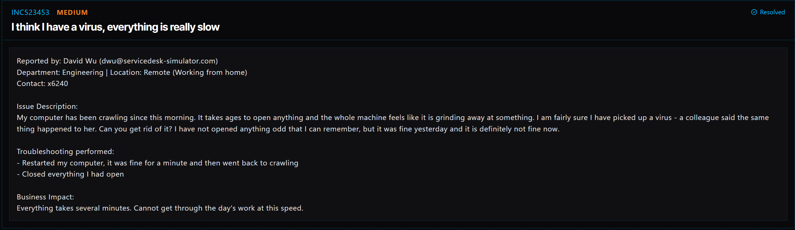

# Ticket 022: Slow Computer Performance Caused by Cloud Drive Sync Issues

## Ticket Information
- **Platform:** ServiceDesk Simulator
- **Incident ID:** INC523453
- **Status:** Resolved
- **Priority:** Medium
- **Ticket Type:** System Performance / Cloud Drive Synchronization
- **Environment:** Simulated IT support environment
- **Reported By:** David Wu
- **Department:** Engineering
- **Location:** Remote (Working from home)
- **Contact:** Extension 6240

## 1. Issue Summary

David Wu from Engineering contacted IT because his computer had become extremely slow. He mentioned that everything was working fine the previous day, but that morning it started taking several minutes to open applications and complete simple tasks.

David suspected that his computer might have a virus because a coworker had experienced something similar.

He had already restarted his computer and closed his open applications, but neither helped. After restarting, the computer briefly worked normally before slowing down again.

I needed to investigate what was causing the slowdown and determine whether it was related to malware or another system issue.

## 2. Business Impact

This ticket was marked Medium priority because the computer was still running, but its performance was making it difficult for David to complete his daily work.

Applications were taking several minutes to respond, which affected his productivity.

Since David worked remotely, resolving the problem through Remote Desktop was important so he could continue working without needing to bring his computer into the office.

## 3. Troubleshooting Performed

1. **Connected to the user's computer:** Opened Tools → Remote Desktop and selected Connect next to David's PC.

2. **Opened Task Manager:** Used the Start menu to launch Task Manager and investigate what was slowing down the computer.

3. **Checked startup applications:** Reviewed the Startup tab and found that the listed applications had recognized publishers. Nothing immediately stood out as suspicious.

4. **Reviewed system processes:** Opened the Processes tab and sorted the columns to check CPU, memory, disk, and network activity.

5. **Checked CPU usage:** Found that CPU usage was nearly idle, which suggested that the processor was not causing the slowdown.

6. **Identified unusual activity:** Noticed that the Cloud Drive synchronization process was using a large amount of disk and network resources without making progress.

7. **Identified the likely cause:** Based on the resource usage, determined that a stuck Cloud Drive synchronization process was causing the performance problem rather than an obvious malware infection.

8. **Restarted synchronization:** Opened Cloud Drive in File Explorer and selected Sync to force the application to synchronize again.

9. **Confirmed with the user:** Contacted David through Company Chat and asked him to confirm whether his computer was running normally again.

## 4. Resolution

The slowdown was caused by a stuck Cloud Drive synchronization process that was continuously using disk and network resources.

After connecting remotely, I used Task Manager to investigate the computer's performance.

The CPU was nearly idle, but Cloud Drive was generating heavy disk and network activity without completing its synchronization.

I opened Cloud Drive through File Explorer and selected Sync to restart the synchronization process.

After the resync, David confirmed through Company Chat that his computer was running at normal speed again.

The ServiceDesk Simulator displayed the ticket as Resolved.

## 5. Verification

**Remote access:** Successfully connected to David's computer using Remote Desktop.

**Startup applications:** Reviewed the Startup tab and found no immediately suspicious publishers.

**CPU usage:** Confirmed that the CPU was nearly idle.

**Resource usage:** Identified unusually high disk and network activity from the Cloud Drive synchronization process.

**Cloud Drive:** Initiated a fresh synchronization using the Sync option.

**User confirmation:** David confirmed through Company Chat that his computer's performance had returned to normal.

**Ticket status:** The ServiceDesk Simulator displayed the incident as Resolved.

**Malware verification:** A full antivirus scan was not documented, so the investigation did not independently rule out every possible security threat.

## 6. Technical Skills Demonstrated

- Remote desktop troubleshooting
- Windows Task Manager
- System performance troubleshooting
- CPU, disk, and network resource monitoring
- Investigating startup applications
- Process analysis
- Cloud Drive synchronization troubleshooting
- Identifying application-related performance problems
- Distinguishing suspected malware from performance issues
- Troubleshooting remote employee workstations
- User communication and issue verification
- Incident documentation and resolution

## 7. Lessons Learned

This ticket taught me that a slow computer doesn't automatically mean it has a virus.

David thought his computer was infected because everything was running slowly, but I needed to investigate before making that assumption.

Using Task Manager helped me narrow down the problem.

At first, I checked the startup applications and CPU usage to see whether something unusual was running.

When I noticed that the CPU was barely being used, I continued checking the other system resources.

That's when I found that Cloud Drive was using a lot of disk and network resources without making progress.

I learned that a background application can cause serious performance problems even when the processor isn't being heavily used.

I also learned why it's important to check the actual system activity instead of immediately assuming the user's suspected cause is correct.

## 8. Evidence

- Screenshot: 

## 9. Reflection

**What would I do differently or investigate further in a real-world IT environment?**

In a real IT environment, I would start by asking David when the slowdown began and whether any updates or new applications had recently been installed.

I would also check whether the issue happened constantly or only when certain applications were running.

Using Task Manager, I would review CPU, memory, disk, and network usage to identify which processes were consuming the most resources.

Since David suspected malware, I would check the status of the company's endpoint protection software and review any recent security alerts.

If the Cloud Drive process was causing the problem, I would review its synchronization status, error messages, and available logs.

I would also check whether there were any file conflicts or network connection issues preventing synchronization from completing.

After restarting the synchronization, I would monitor resource usage again to confirm that disk and network activity had returned to normal.

Finally, I would ask David to test the applications he normally uses and confirm that his computer was working properly before closing the ticket.

This experience reminded me that troubleshooting is about finding evidence, narrowing down possible causes, and verifying that the solution actually works.
  
